<!-- 作品报告正文。scripts/build_report.py 把本文件套入官方《作品报告》模板，生成 Word 与 PDF。
     标记说明：# 一级标题（章），## 二级，### 三级； 插图；$$公式$$ 单独成行的公式；
     表格用 Markdown 表格，表格上一行写“表 x-x 标题”。 -->

# 摘要

数据分类分级是数据共享与开放的前提。现行做法逐个字段判断等级，判定的是“这个字段本身泄露有多严重”，但接收方真正能做的，是把它能拿到的若干字段合起来，用模型推断出它无权获取的数据。例如企业对外报送的碳排放数据，单独一项就能把 15 分钟粒度的用电量还原到拟合优度 0.98；三项各自无害的功率因数和时刻字段合起来，也能越过判定线。这类聚合推断风险在逐字段定级中是看不见的。

本作品设计并实现了面向聚合推断威胁的数据定级与共享审查系统。系统先依据国家标准 GB/T 43697，由大语言模型逐字段初判、人工或另一个大模型复核，得到一次等级；再按“各类接收方按等级能拿到哪些字段”，用成批并行训练的推断模型实测这些字段组合能把保护对象推到多准，计算每个字段的推断敏感度和最小越线组合；然后把等级方案的选择建模为组合决策，用组相对策略优化（一种强化学习方法）在安全收益、可用性成本和聚合推断惩罚之间求整套等级方案，并对每类接收方合并全部可见字段重新训练核对，换用梯度提升树复测。

在电力市场、区域电网实测、社区统计、医疗保险、钢铁企业用电、楼宇人员在室 6 个数据集上测试：最小越线组合由合计 2014 个降至 11 个；强化学习得到的方案在 5 个任务上与精确最优相同，另一个相差 0.4%。系统支持上传一张数据表后在后台自动完成全流程，自动选择显卡或处理器，每次调级都给出依据。

# 第一章 作品概述

## 1.1 背景分析

《中华人民共和国数据安全法》第二十一条要求国家建立数据分类分级保护制度，各地区、各部门对本地区、本部门以及相关行业、领域的数据分类分级，确定重要数据目录。2024 年发布的国家标准 GB/T 43697《数据安全技术 数据分类分级规则》给出了统一的方法：按数据一旦遭到泄露、篡改、损毁或者非法获取、非法使用、非法共享，对国家安全、经济运行、社会秩序、公共利益、组织权益、个人权益造成的危害程度，把数据分为核心数据、重要数据和一般数据，一般数据再细分为 1 至 4 级，并规定了不同等级的共享范围。

按照这套方法，定级的对象是单个数据项，判断依据是这个数据项本身泄露后的影响。数据共享时，接收方按授权拿到某一等级及以下的全部数据项。问题在于，接收方并不是逐项孤立地使用这些数据：多个低等级字段合起来，可以用统计或机器学习模型推断出接收方无权获取的高等级数据。这在数据库安全领域称为推断问题或聚合问题[5][6]。它在今天更突出，原因有三：

（1）数据粒度越来越细。电力、能源、工业领域逐小时、逐 15 分钟的运行数据，彼此之间有很强的物理关联，一项数据往往能近似还原另一项。

（2）对外报送与开放的数据越来越多。碳排放、能耗、价格等数据按规定公开或报送，接收方能拿到的“背景知识”远多于以往。

（3）推断工具门槛很低。一个普通的神经网络就能从几列数据中学出对另一列的高精度预测。

本作品第三章的钢铁企业用电数据就是一个典型例子：企业 15 分钟粒度的用电量反映生产安排，应受控；而它的碳排放数据由用电量折算而来，单独一项就能把用电量还原到 0.979。另外，滞后功率因数、超前功率因数、当天时刻三项单独推断用电量都不超过 0.7，合起来却达到 0.81。只看单个字段定级，这两类风险都发现不了。

## 1.2 相关工作

**数据分类分级。** GB/T 43697[1] 给出了判定表和各类数据的最低参考级别，GB/T 35273[4] 规定了个人信息与敏感个人信息的范围。现有的自动化分级工具多采用关键词与正则匹配、规则引擎，或用机器学习、大语言模型对字段名称和样本内容做分类，解决的是“这个字段属于哪一类、该定几级”，不考虑字段之间的推断关系。

**推断控制。** 统计数据库的推断控制研究由来已久[5]，多级安全数据库中的推断通道检测与消除也有系统综述[6]。这些方法多依赖事先给定的函数依赖或约束，难以覆盖数值数据之间学习得到的近似关系。k-匿名[7]、差分隐私[8]通过泛化或加噪声保护个体，针对的是记录级的再识别，而不是字段级的等级划定。模型反演[9]等工作说明，机器学习模型可以从可见属性推断敏感属性，这也正是本作品用来度量风险的方式。

**组合决策与强化学习。** 为一组字段同时确定等级是一个离散组合优化问题。组相对策略优化（GRPO）[10]是在近端策略优化[11]基础上提出的方法，每一步对同一任务采样一组完整解，以组内相对好坏作为优势，不需要另外训练价值网络，适合这种“整套方案一次打分”的问题。

**本作品的位置。** 本作品不替代逐字段定级，而是在其后增加一步：用模型实测聚合推断风险，并把它计入等级。它与推断控制的区别在于不依赖事先给定的依赖关系，而是直接用推断模型在留出数据上的精度说话；与匿名化和差分隐私的区别在于不改动数据本身，只调整共享范围。

## 1.3 特色描述

（1）**定级依据公开标准，过程留痕。** 规则库来自 GB/T 43697 的条文、判定表和最低参考级别；大模型只判断影响对象和影响程度，等级由判定表查出；人工或另一个大模型复核，改动保留初判与理由。

（2）**风险用模型实测，不靠经验判断。** 对每类接收方能凑齐的字段组合训练推断模型，以留出数据上的拟合优度作为推断精度，并给出推断值与真实值的对照曲线。

（3）**把整套等级方案当作一个决策。** 一个字段只能有一个等级，却同时影响多个保护对象、多类接收方。系统用强化学习在安全与可用性之间权衡，并用穷举或整数规划求精确最优作参照，结果可以核对。

（4）**每次调级都能说清原因。** 直接定级给出敏感度 M；联合评估给出“保持原级与调高后整套方案的效用差”；整体核对给出合并全部字段后的推断精度。降回原级会重新成立哪些越线组合，也逐条列出。

（5）**上传一张表即可运行。** 大模型根据列名和示例值起草字段目录，用户确认后，后台自动完成一次定级、复核、推断验证、二次定级与核对，自动选择空闲显卡，没有显卡时用处理器。

## 1.4 应用前景分析

（1）**数据共享与开放前的审查。** 政府部门、公共数据运营机构开放数据前，可用本系统检查拟开放的字段组合会不会推出未开放的数据，据此调整开放范围。

（2）**行业数据的分类分级。** 电力、能源、工业企业的运行数据粒度细、关联强，聚合推断风险突出。系统内置的电力市场算例和钢铁企业算例说明了这类场景。

（3）**数据交易与合作中的授权设计。** 按接收方类别分别评估，可为不同合作方确定可提供的字段清单。

（4）**合规自查与审计。** 系统输出定级台账、调级依据和接收方推断能力的前后对比，可直接作为分类分级工作的记录材料。

# 第二章 作品设计与实现

## 2.1 总体方案

系统的技术路线如图 2-1 所示，分五步：一次定级只看字段本身；推断验证实测各类接收方能拿到的字段合起来能把保护对象推到多准；风险分析给出单字段风险、字段推断敏感度和最小越线组合；二次定级把聚合推断风险计入等级；效果复核比较调级前后各接收方的推断能力，并换用另一种模型复测。

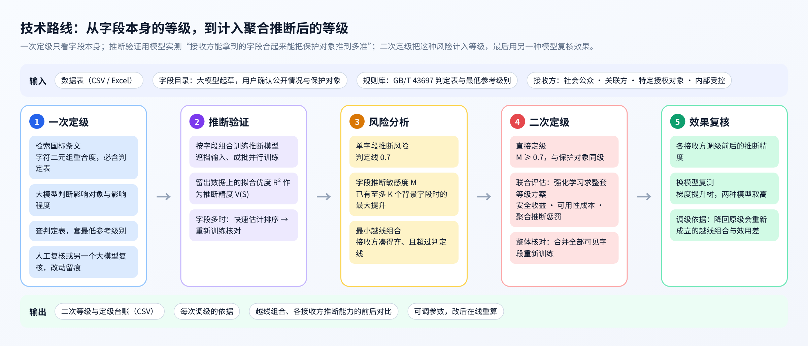

系统分为界面层、服务层、计算层和资源层（图 2-2）。界面层在浏览器中运行；服务层提供 HTTP 接口，管理任务与后台作业，并为计算选择设备；计算层包括流水线、定级引擎和推断引擎；资源层是大语言模型、规则库、数据与算力。

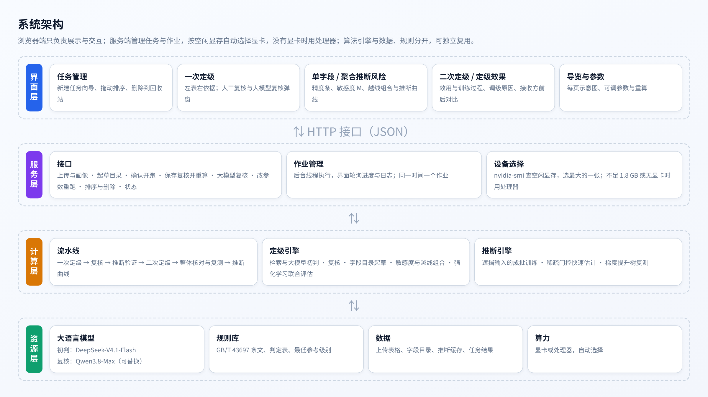

## 2.2 问题定义

设数据表有候选字段 x₁, …, xₙ 和保护对象 y₁, …, yₘ。保护对象是不应被无权者获取、需要防止被其他字段推断出来的数据。每个字段有一个等级 a ∈ {1, 2, 3, 4}。参照 GB/T 43697 对一般数据共享范围的规定，系统设四类接收方：社会公众可获取 1 级数据，关联方可获取 2 级及以下，特定授权对象可获取 3 级及以下，内部受控范围可获取全部。

接收方 c 能拿到的候选字段集合为

$$V_c(a) = \{\, i : a_i \leq c \,\}$$

对保护对象 y，若其等级高于 c，接收方 c 无权获取它。推断精度定义为用字段组合 S 训练的推断模型在留出数据上的拟合优度：

$$V(S) = R^2_{\mathrm{test}}\left(y,\ f_S(x_S)\right)$$

V(S) 取 0 至 1，0 表示推不出，1 表示完全还原。当 V(S) 超过判定线时，认为接收方能推出 y。判定线是可调参数，默认对社会公众取 0.7，对其他接收方取 0.8。若接收方 c 能凑齐组合 S（S 中各字段等级都不高于 c）、无权获取 y，且 V(S) 超过判定线，则称 S 对 (c, y) 越线；去掉其中任何一个字段都不再越线的组合称为最小越线组合。

二次定级的目标是：在一次等级的基础上只升不降地调整等级，使越线组合尽量被拆开，同时尽量少地缩小共享范围。

## 2.3 一次定级

一次定级流程如图 2-3 所示。

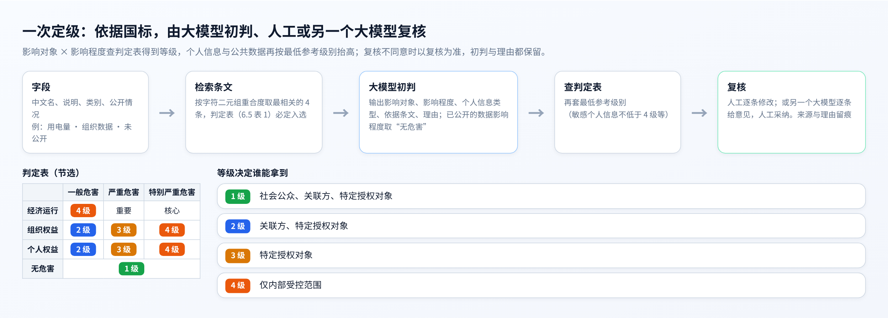

**规则库。** 从 GB/T 43697 中整理出 12 条与定级直接相关的条文（定级要素、判定表、一般数据分级、个人信息与公共数据的最低参考级别、衍生数据、动态更新等），以及判定表（影响对象 × 影响程度 → 等级）和最低参考级别（如敏感个人信息不低于 4 级、有条件开放的公共数据不低于 2 级）。

**检索。** 对每个字段，把中文名、说明和类别拼成查询，按字符二元组的重合度从规则库中取最相关的 4 条条文，判定表一条必定入选。字符二元组检索不依赖分词和向量模型，结果稳定，便于审计。

**大模型初判。** 把检索到的条文和字段信息交给大语言模型（DeepSeek-V4.1-Flash，温度 0，结构化输出），只要求它判断两件事：数据一旦泄露最主要的影响对象和影响程度；若属于个人信息，再判断是敏感个人信息还是一般个人信息。模型同时输出依据的条文编号和不超过 60 字的理由。已对外公开的数据，影响程度取“无危害”。

**查表得等级。** 等级不由大模型直接给出，而是用影响对象和影响程度查判定表，再按个人信息类型或公共数据开放情况套用最低参考级别。这样大模型的判断可以逐项核对，等级的计算完全可复现。

**复核。** 复核有两种方式：人工在界面上逐条修改影响对象和影响程度，等级按判定表即时更新；或请另一个大模型（Qwen3.8-Max）逐条复核，它给出不同意见和理由，由人工逐条或全部采纳。复核意见以文件保存，记录来源与理由；与初判不一致的，以复核为准，初判与理由都保留在结果中。

**字段目录起草。** 上传的数据表只有列名和数值。系统先逐列判断数值、类别、时间、文本四种类型，统计缺失与示例值，再请大模型起草每一列的中文名、说明、类别、公开情况，并建议哪些列可能是保护对象。公开情况和保护对象属于业务判断，必须由用户确认；第三章的测试也说明了这一点。

## 2.4 推断验证

推断验证的原理如图 2-4 左半部分所示。

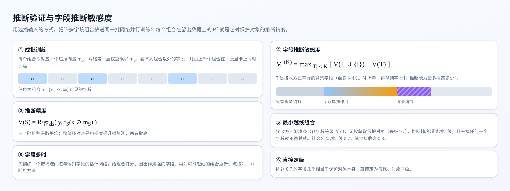

**成批并行训练。** 若对每个字段组合单独训练一个模型，组合数一多就无法承受。系统把许多组合放进同一批网络并行训练：每个组合 S 对应一个遮挡向量 m_S（S 中字段对应的输入列为 1，其余为 0），网络第一层权重逐元素乘以 m_S，使网络看不到组合以外的字段。所有组合的网络参数堆成一个张量，一次前向和反向计算同时更新，一张显卡上可同时训练数百至上千个组合。网络为两层隐藏层（64、32）的全连接网络，训练 80 轮，留出 20% 的数据计算拟合优度；保护对象有多个分量时取各分量的平均，类别型保护对象做独热编码。每个组合用 3 个随机种子训练，取平均。

**组合范围。** 候选字段不超过 8 个时训练全部组合；更多时训练不超过 3 个字段的全部组合。社区统计这类有 95 个候选字段的数据，不超过 3 个字段的组合有十几万个，系统先训练一个快速估计网络：输入端每个字段带一个门控值，训练时加稀疏约束，并混入随机生成的诱饵字段作为对照，门控值不高于诱饵的字段视为无关；估计网络对全部组合打分后，只对可能越线的组合及其子集重新训练核对，并随机抽查 400 个组合检验是否漏掉。快速估计只用来排序和筛选，所有用于定级的推断精度都来自重新训练。

## 2.5 风险分析

**单字段推断风险。** V({i}) 表示字段 i 单独推断保护对象的精度，用于发现“一项就能还原”的字段。

**字段推断敏感度。** 接收方往往已经掌握一些其他字段（背景）。字段 i 的推断敏感度定义为：在至多 K 个背景字段的所有组合中，再加入字段 i 带来的最大提升（图 2-4 右半部分）：

$$M_i^{(K)} = \max_{|T| \leq K}\left[\, V(T \cup \{i\}) - V(T) \,\right]$$

K = 0 时就是单字段精度；K 越大，越能发现“单独作用不大、与背景一起作用大”的字段。K 默认取 2，上限取决于推断验证精确计算到的组合规模。

**最小越线组合。** 对每类接收方和每个保护对象，在已核对的组合中找出全部最小越线组合，作为二次定级要拆开的对象。图 2-5 是钢铁企业用电数据中的一个例子。

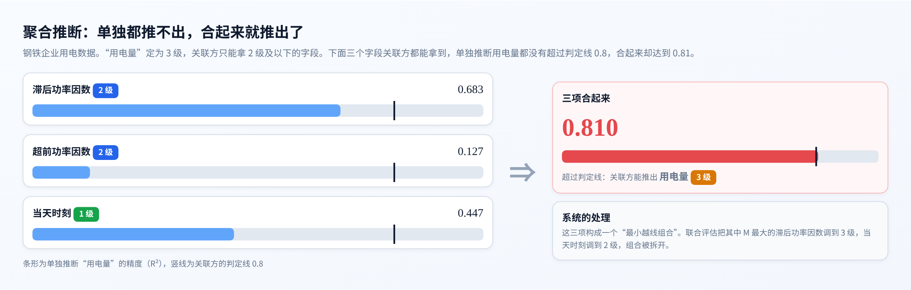

## 2.6 二次定级

二次定级分三步（图 2-6）。

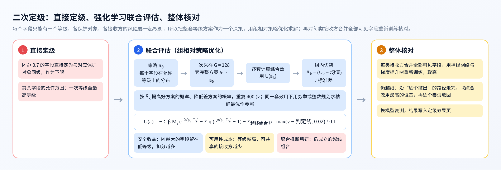

**（1）直接定级。** M 不低于直接定级线（默认 0.7）的字段，几乎相当于保护对象本身，直接定为与对应保护对象同级，作为该字段等级的下限。

**（2）联合评估。** 其余字段的等级要在整体上权衡：一个字段只能有一个等级，却可能同时出现在多个保护对象、多类接收方的越线组合中；调高它能拆开组合，但会缩小共享范围。系统把整套等级方案 a = (a₁, …, aₙ) 作为一个决策，定义综合效用：

$$U(a) = -\sum_i \beta M_i e^{-\lambda (a_i - L_i)} - \sum_i \eta \left(e^{\sigma (a_i - L_i)} - 1\right) - \sum_{(c,S)\ \mathrm{active}} \rho \cdot \frac{\max(v_S - \theta_c,\ 0.02)}{0.1}$$

其中 Lᵢ 为一次等级，Mᵢ 为字段对各保护对象的敏感度最大值。三项都是扣分：第一项是安全收益，M 越大的字段留在低等级扣分越多，每升一级，这一项缩小为原来的 exp(−λ) 倍；第二项是可用性成本，等级每升一级，能共享的接收方变少，成本按指数增长；第三项是聚合推断惩罚，对调整后仍然成立的每个越线组合 (c, S)，按其推断精度超出接收方 c 判定线的幅度扣分，刚过线的也至少按 0.02 计。默认 β = 2.5，λ = 1，η = 1，σ = 0.5，ρ = 2，均可在界面上修改后重算。

用组相对策略优化求解。策略网络读取每个字段的 5 项特征（一次等级、等级下限、M、所在越线组合的罚分占比、权重），加上每个字段自己的偏置，输出该字段在允许等级上的概率分布。每一步从策略中采样 G = 128 套完整方案，逐套计算 U，按组内标准化的相对优势更新策略：

$$\hat{A}_k = \frac{U(a_k) - \mathrm{mean}(U)}{\mathrm{std}(U)}, \qquad \mathcal{L}(\theta) = -\frac{1}{G}\sum_{k=1}^{G} \hat{A}_k \log \pi_\theta(a_k) - \gamma\, \mathcal{H}(\pi_\theta)$$

熵奖励 γ 随训练逐步减小，共训练 400 步，取训练中遇到的最好方案。为了检验结果，系统在同一套效用下求精确最优作参照：方案数不超过 30 万时穷举，否则把问题写成整数线性规划求解。

**（3）整体核对。** 越线组合只覆盖了不超过 3 个字段的组合。为防止“更多字段合起来”仍然越线，系统对每类接收方，用它在新等级下能拿到的全部字段重新训练神经网络和梯度提升树，取两者中较高的推断精度。若仍超过判定线，就沿“逐个撤出字段”的路径走：每一步用快速估计网络给候选字段排序，取前 6 个重新训练核对，撤出效用损失与剩余惩罚之和最小的一个；整条路径走完后，取综合效用（此时加上整体推断惩罚）最高的位置，再逐个尝试把撤出的字段放回。默认不要求严格消除所有越线，可在参数中开启严格模式。

## 2.7 效果复核与调级依据

**换模型复测。** 用没有参与定级的直方图梯度提升树，对每类接收方在调级前后能拿到的全部字段，重新测一遍对每个保护对象的推断精度，与神经网络的结果并列，任一模型超过判定线即视为越线。

**调级依据。** 对每个调高的字段，系统给出：直接定级时的 M 及对应保护对象；联合评估时“只改这个字段的等级、其他字段不动”在各等级下的整套方案效用，以及保持原级与现等级之间安全收益、可用性成本、聚合推断惩罚各自的变化；降回原级会重新成立的越线组合。

**仅凭公开数据即可推出的情形。** 若某保护对象仅凭所有接收方都已掌握的数据就能推出，调整候选字段的等级不起作用，系统单独标出，交由数据主管方另行处理。

## 2.8 系统实现

**技术栈。** 服务端用 Python 标准库实现 HTTP 服务，推断与优化用 PyTorch，换模型复测用 scikit-learn，整数规划用 SciPy；界面为原生 JavaScript 与 ECharts，不依赖外部网络资源。没有安装深度学习库时以演示方式运行，只查看内置结果。

**设备选择。** 通过 nvidia-smi 查询每张显卡的空闲显存，选择空闲最多的一张；都不足 1.8 GB 或没有显卡时使用处理器。查询不在进程内建立显卡上下文，避免在共享服务器上额外占用显存。

**后台作业。** 新建任务的流水线依次执行一次定级、复核、推断验证、二次定级、整体核对与复测、推断曲线，进度和日志写入文件，界面每 2 秒刷新；关闭页面不影响运行。

**大模型调用。** 起草目录、一次定级、复核三处调用统一封装：失败时在“经代理”和“直连”两种方式之间切换重试；密钥写在单独的配置文件中，不进入代码。

**界面。** 系统包括任务管理和定级流程五页（图 2-7 至图 2-13）。

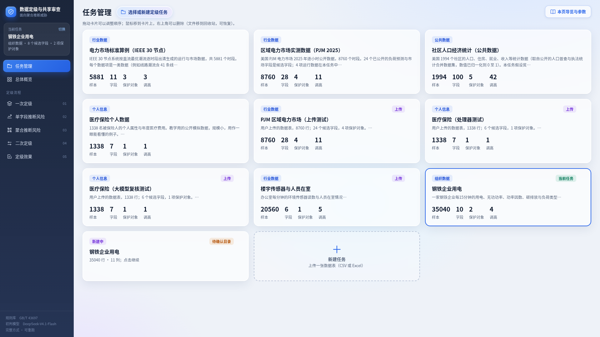

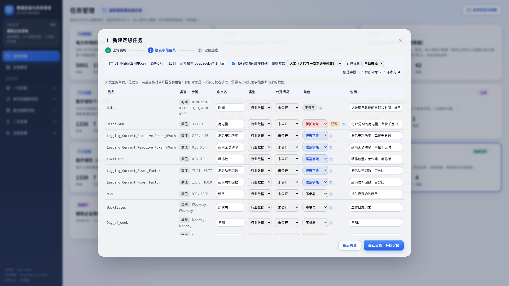

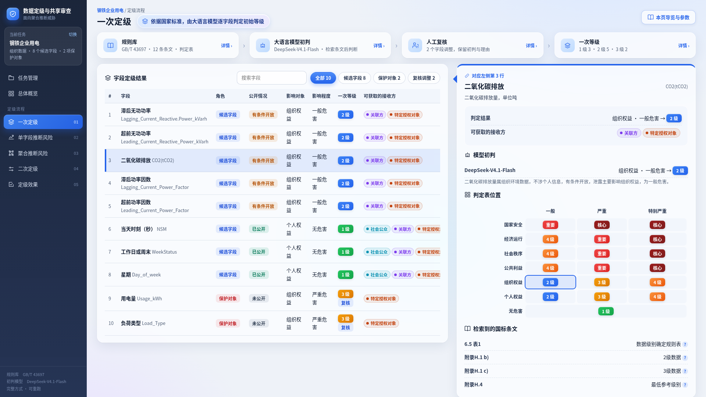

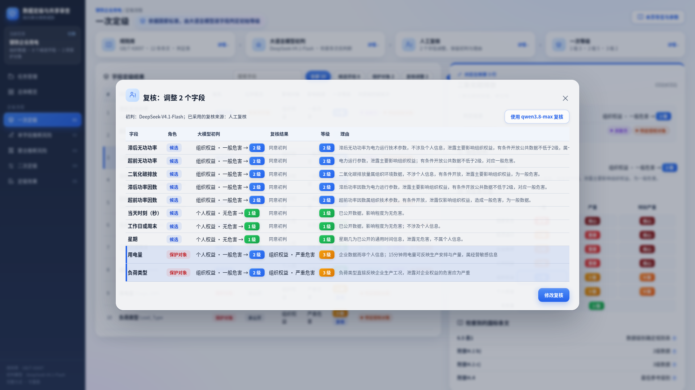

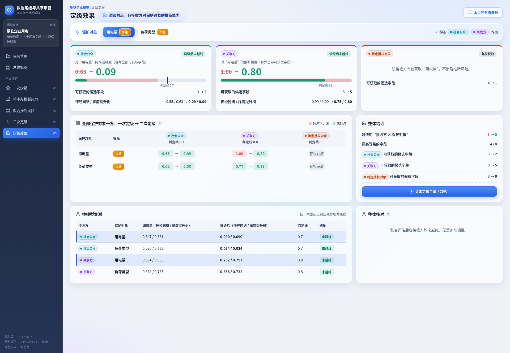

## 2.9 功能与指标

表 2-1 主要功能

| 功能 | 说明 |
|---|---|
| 新建任务 | 上传 CSV 或 Excel；逐列画像；大模型起草字段目录；用户确认公开情况、保护对象、时间序列、复核方式与计算设备 |
| 一次定级 | 检索国标条文，大模型初判影响对象与影响程度，查判定表与最低参考级别 |
| 复核 | 人工逐条修改；或另一个大模型复核，意见可逐条或全部采纳；保存后自动重算 |
| 推断验证 | 成批并行训练字段组合的推断模型；字段多时快速估计加重新训练核对 |
| 风险分析 | 单字段推断风险、字段推断敏感度（K 可调）、最小越线组合、推断曲线 |
| 二次定级 | 直接定级、强化学习联合评估、整体核对；可只保护某一项保护对象另算 |
| 效果复核 | 各接收方调级前后的推断精度、换模型复测、调级依据、定级台账导出 |
| 参数调整 | 判定线、直接定级线、K、效用函数各系数、训练步数与组大小、严格模式，改后在线重算 |
| 任务管理 | 拖动排序；删除到回收站，可恢复 |

表 2-2 主要指标（测试结果见第三章）

| 指标 | 结果 |
|---|---|
| 支持的数据 | 数值、类别字段；时间与文本字段自动排除；单表 50 行以上 |
| 推断验证规模 | 单个任务重新训练核对 32 至 3809 个字段组合；95 个候选字段时快速估计 15276 个组合用时 0.8 秒 |
| 越线组合 | 6 个任务合计由 2014 个降至 11 个 |
| 强化学习的最优性 | 5 个任务与精确最优相同，1 个相差 0.4% |
| 全流程用时 | 上传测试任务在显卡上 3 至 10 分钟；小数据在处理器上 37 秒 |
| 运行环境 | 有无显卡均可；无深度学习库时以演示方式查看结果 |

# 第三章 作品测试与分析

## 3.1 测试方案

测试围绕四个问题展开：（1）一次定级与复核是否可靠；（2）系统能否发现并消除聚合推断风险；（3）强化学习求得的方案离精确最优有多远，代价是什么；（4）从上传数据表开始的全流程能否在不同设备上运行，结果是否与脚本计算一致。

## 3.2 测试环境

表 3-1 测试环境

| 项目 | 配置 |
|---|---|
| 处理器 | Intel Xeon Platinum 8380，160 线程 |
| 内存 | 251 GB |
| 显卡 | NVIDIA GeForce RTX 4090（24 GB）× 4，测试中最多并行使用 3 张 |
| 软件 | Python 3.10，PyTorch 2.5.1，scikit-learn 1.7.2，pandas 2.3.3，SciPy |
| 大语言模型 | 初判与起草目录：DeepSeek-V4.1-Flash；复核：Qwen3.8-Max |
| 界面测试 | Chromium 浏览器自动化，逐页截图检查脚本错误 |

## 3.3 测试数据

测试使用 6 个公开数据集（表 3-2），覆盖电力仿真、电力市场实测、公共统计、个人信息、企业用能和楼宇传感器。保护对象是为测试设定的“未公开数据”，其余字段按实际情况设定公开情况。

表 3-2 测试数据集

| 数据集 | 样本数 | 候选字段 | 保护对象（一次等级） | 来源 |
|---|---|---|---|---|
| IEEE 30 节点 | 5881 | 8 类 | 线路潮流（4）、节点相角（4）、机组报价（3） | 在 IEEE 30 节点标准算例[12]上按直流最优潮流逐时段出清生成 |
| PJM 2025 | 8760 | 24 | 实际网损（2）、发电总出力（4）、实际总交换功率（4）、联络线净交换功率（4） | PJM 公开数据[13] |
| 社区统计 | 1994 | 95 | 贫困人口比例等 5 项（均为 4） | UCI 社区与犯罪数据集[14] |
| 医疗保险 | 1338 | 6 | 医疗费用（4） | 公开教学数据[15] |
| 钢铁企业用电 | 35040 | 8 | 用电量（3）、负荷类型（3） | UCI 钢铁企业用电数据集[16] |
| 楼宇人员在室 | 20560 | 5 | 是否有人（3） | UCI 楼宇人员在室数据集[17] |

钢铁企业用电与楼宇人员在室两个数据集，是通过界面上传、走完新建任务全流程得到的。

## 3.4 一次定级与复核

6 个任务共 162 个字段由大模型初判，人工复核调整 19 个（11.7%）。调整主要有两类：

（1）**影响对象判错。** 例如钢铁企业的用电量被判为“个人权益”，复核改为“组织权益”；办公室湿度比被判为“公共利益”而定为 4 级，复核改为与其他室内环境读数相同的“组织权益”、2 级。

（2）**危害程度偏低。** 大模型倾向于把保护对象判为“一般危害”，与候选字段同为 2 级。这样能拿到候选字段的接收方本就有权获取保护对象，不存在越权推断。复核按数据的实际敏感程度调整，例如逐分钟的在室记录反映个人行踪，15 分钟粒度的企业用电量反映生产安排，均改为“严重危害”（3 级）。

另用 Qwen3.8-Max 对医疗保险任务的 7 个字段做大模型复核，它同意 6 条初判，对“医疗费用”提出应为“严重危害”的意见；该字段按敏感个人信息的最低参考级别本就是 4 级，等级不变。

字段目录起草方面，大模型对列名的解读基本可用，但公开情况与保护对象的建议偏差较大：对 PJM 的 28 列全部建议“已公开”、不设保护对象，对医疗保险的 7 列则全部建议为保护对象。这说明公开情况和保护对象必须由用户确认，系统在界面上也是这样设计的。

## 3.5 聚合推断风险与二次定级效果

表 3-3 二次定级结果

| 数据集 | 最小越线组合 | 调高字段（直接 / 联合 / 核对） | 越线的“接收方×保护对象” | 联合评估与精确最优 |
|---|---|---|---|---|
| IEEE 30 节点 | 10 → 0 | 3（1 / 2 / 0） | 5 → 0 | −7.92 / −7.92（穷举） |
| PJM 2025 | 15 → 0 | 11（2 / 8 / 1） | 7 → 5 | −21.81 / −21.81（整数规划） |
| 社区统计 | 1982 → 11 | 42（12 / 30 / 0） | 13 → 11 | −101.52 / −101.10（整数规划） |
| 医疗保险 | 2 → 0 | 1（1 / 0 / 0） | 2 → 0 | −2.70 / −2.70（穷举） |
| 钢铁企业用电 | 4 → 0 | 4（2 / 2 / 0） | 1 → 0 | −7.66 / −7.66（穷举） |
| 楼宇人员在室 | 1 → 0 | 5（1 / 4 / 0） | 1 → 0 | −5.90 / −5.90（穷举） |

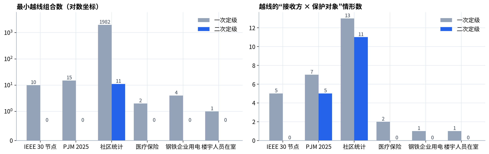

6 个任务的最小越线组合合计由 2014 个降至 11 个，其中 5 个任务全部拆开。越线的“接收方×保护对象”情形由 29 个降至 16 个。

**钢铁企业用电。** 碳排放单独推断用电量 0.979，滞后无功功率 0.856，二者直接定为 3 级；滞后功率因数、超前功率因数、当天时刻三项构成的组合达到 0.81，联合评估把其中敏感度最大的滞后功率因数调到 3 级、当天时刻调到 2 级，组合被拆开。图 3-2 是各接收方合并全部可获取字段后的推断精度：社会公众对用电量的推断精度由 0.631 降至 0.090，关联方由 0.998 降至 0.797，均降到判定线以下。系统给出的调级依据显示，滞后功率因数若保持 2 级，整套方案效用为 −8.90；调到 3 级后为 −7.66，其中安全收益增加 1.08、聚合推断惩罚减少 0.80，可用性成本增加 0.65。

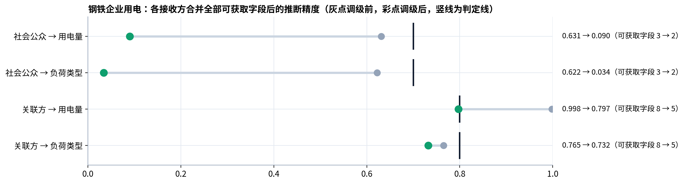

**PJM 与社区统计仍有越线。** 两者都还有部分“接收方×保护对象”超过判定线。原因有二：一是这些保护对象与大量字段高度相关（例如发电总出力与负荷、价格类字段），要压到线下需要调高很多字段；二是系统默认不要求严格消除越线，而是按综合效用取舍。整体核对在 PJM 中把社会公众对保护对象的推断精度由 0.857 降至 0.751，在社区统计中由 0.900 降至 0.863。若业务上要求不留越线，可开启严格模式，代价是共享范围明显缩小。系统把这些剩余风险如实列在定级效果页。

## 3.6 方法有效性

**强化学习与精确最优。** 图 3-3 比较了只做一次定级、联合评估和精确最优三种方案的综合效用。联合评估在 5 个任务上与精确最优完全相同；社区统计有 95 个字段、近两千个越线组合，相差 0.4%。图 3-4 是训练过程，组内平均效用在 PJM 上约 70 步、在社区统计上约 270 步进入精确最优的 5% 以内。精确最优在字段较多时依赖整数规划求解器；强化学习不依赖问题的线性结构，在效用中加入整体推断惩罚这类不能写成线性约束的项后仍然可用，这是采用它的原因。

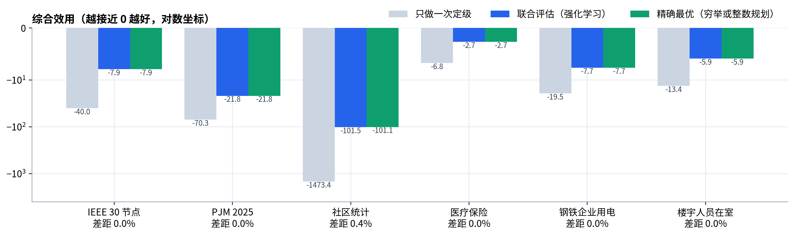

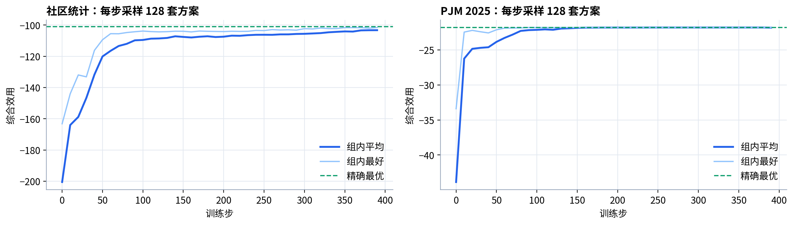

**快速估计的作用。** 社区统计有 95 个候选字段，快速估计网络圈出作用较强的 45 个字段，0.8 秒内对 15276 个组合打分；随后重新训练核对 3809 个组合，用时 18.2 秒。估计值与重新训练值的平均绝对误差为 0.068，随机抽查 400 个组合，没有发现被筛掉却实际越线的组合。这说明估计适合用来排序和筛选，但精度不足以直接用于定级，因此系统中所有用于定级的推断精度都来自重新训练。

**换模型复测。** 对各任务接收方能拿到的全部字段，神经网络与梯度提升树的推断精度变化方向一致，但数值有差别。例如钢铁企业中关联方对用电量的推断精度，调级前分别为 0.994 和 0.998，调级后分别为 0.752 和 0.797；社会公众对用电量，调级前神经网络为 0.547、梯度提升树为 0.631。单用一种模型可能低估风险，所以系统取两者中较高的值。

## 3.7 全流程与性能

**上传全流程。** 以 PJM 的 28 列数据存为 Excel 上传，由大模型起草目录，用户指定与内置任务相同的 4 项保护对象，再按内置任务的复核意见修改一处。重算后，24 个候选字段的一次、二次等级，越线组合（15 → 0），以及最终效用（−29.04）与用脚本计算的内置任务完全一致。用医疗保险数据在处理器上测试，结果也与内置任务一致。

表 3-4 全流程用时（含一次定级与复核的大模型调用）

| 任务 | 设备 | 用时 |
|---|---|---|
| PJM 2025（Excel，28 列） | 显卡 | 559 秒 |
| 钢铁企业用电 | 显卡 | 484 秒 |
| 楼宇人员在室 | 显卡 | 177 秒 |
| 医疗保险 | 处理器 | 37 秒 |
| 医疗保险（另加大模型复核） | 处理器 | 84 秒 |

**界面测试。** 用浏览器自动化逐个打开 6 个任务的全部页面并截图，检查脚本错误为 0；对拖动排序、删除、K 调整、复核保存与重算、大模型复核与采纳等操作逐项实测通过。

## 3.8 结果分析

测试表明：（1）逐字段定级确实漏掉了聚合推断风险，6 个任务在一次定级后都存在越线组合；（2）系统能找出这些组合并给出可解释的调级，多数任务的越线组合全部拆开；（3）强化学习的结果与精确最优一致或接近，且能处理非线性的整体推断惩罚；（4）大模型适合做初判和起草，公开情况、保护对象和危害程度仍需人工把关。

局限在于：推断验证以不超过 3 个字段的组合为主，更大的组合由整体核对兜底，但不能逐一列出；推断精度依赖所选模型，系统用两种模型取高来降低低估的可能；判定线和效用系数需要结合业务设定。

# 第四章 创新性说明

**（1）把聚合推断风险定量地计入数据分级。** 现有分类分级只判断单个数据项的泄露影响。本作品按接收方的授权范围，实测其能拿到的字段组合对保护对象的推断精度，用字段推断敏感度和最小越线组合刻画风险，并据此调整等级。风险的度量不依赖专家对字段关系的事先判断。

**（2）提出字段推断敏感度，区分“单独作用”和“背景增益”。** 敏感度定义为已有至多 K 个背景字段时再加入该字段的最大提升，既能发现单独就能还原保护对象的字段，也能发现单独作用不大、与背景一起作用大的字段；界面上把精度分解为“只有背景、单独作用、背景增益”三段展示。

**（3）用组相对策略优化求整套等级方案，并以精确最优校验。** 把各字段的等级作为一个整体决策，效用由安全收益、可用性成本和聚合推断惩罚三部分组成；采用组内相对优势的强化学习方法求解，不需要价值网络；同时用穷举或整数规划求精确最优作参照，在 6 个任务上的差距不超过 0.4%。

**（4）大模型初判、标准查表、人工或另一个大模型复核的可审计定级流程。** 大模型只判断影响对象和影响程度，等级由国标判定表和最低参考级别算出；复核意见记录来源与理由，可由另一个大模型给出、人工采纳。每一步都能追溯。

**（5）大规模字段组合的成批并行验证。** 用遮挡输入把数百上千个字段组合放进同一批网络并行训练；字段多时用带诱饵的稀疏门控网络快速估计、重新训练核对、随机抽查，在 95 个字段的数据上 20 秒内完成数千个组合的核对。

# 第五章 总结

本作品针对逐字段定级看不到聚合推断风险的问题，设计并实现了面向聚合推断威胁的数据定级与共享审查系统。系统以 GB/T 43697 为规则依据，由大模型初判、人工或另一个大模型复核得到一次等级；以成批并行训练的推断模型实测各类接收方的推断能力，计算字段推断敏感度与最小越线组合；用强化学习在安全与可用性之间求整套等级方案，并以整体核对和换模型复测检验效果。在 6 个公开数据集上，系统把最小越线组合由 2014 个降至 11 个，强化学习结果与精确最优的差距不超过 0.4%。系统支持上传数据表后在后台完成全流程，每次调级都给出依据，可作为数据共享与开放前的审查工具。

后续工作包括：支持多张表关联后的推断验证；引入时间维度，对动态更新的数据做增量复核；把接收方的背景知识（例如已公开的外部数据）显式纳入推断验证；结合更多行业标准扩充规则库。

**团队分工。** 本作品由 4 名成员共同完成，分工见表 5-1。

表 5-1 团队分工

| 成员 | 主要工作 |
|---|---|
| 成员甲（队长） | 总体方案；二次定级算法（效用函数、强化学习联合评估、整体核对）；作品报告统稿 |
| 成员乙 | 推断验证引擎（成批并行训练、快速估计、换模型复测）；性能测试 |
| 成员丙 | 规则库整理；一次定级与复核（大模型初判、大模型复核、字段目录起草）；测试数据集整理与人工复核 |
| 成员丁 | 系统界面与服务端（任务管理、各页面、后台作业、设备选择）；界面测试；演示视频 |

# 参考文献

[1] 全国网络安全标准化技术委员会. 数据安全技术 数据分类分级规则: GB/T 43697—2024[S]. 北京: 中国标准出版社, 2024.

[2] 中华人民共和国数据安全法[Z]. 2021-06-10.

[3] 中华人民共和国个人信息保护法[Z]. 2021-08-20.

[4] 全国信息安全标准化技术委员会. 信息安全技术 个人信息安全规范: GB/T 35273—2020[S]. 北京: 中国标准出版社, 2020.

[5] DENNING D E. Cryptography and data security[M]. Reading: Addison-Wesley, 1982.

[6] FARKAS C, JAJODIA S. The inference problem: a survey[J]. ACM SIGKDD Explorations Newsletter, 2002, 4(2): 6-11.

[7] SWEENEY L. k-anonymity: a model for protecting privacy[J]. International Journal of Uncertainty, Fuzziness and Knowledge-Based Systems, 2002, 10(5): 557-570.

[8] DWORK C. Differential privacy[C]//Automata, Languages and Programming: ICALP 2006. Berlin: Springer, 2006: 1-12.

[9] FREDRIKSON M, JHA S, RISTENPART T. Model inversion attacks that exploit confidence information and basic countermeasures[C]//Proceedings of the 22nd ACM SIGSAC Conference on Computer and Communications Security. New York: ACM, 2015: 1322-1333.

[10] SHAO Z, WANG P, ZHU Q, et al. DeepSeekMath: pushing the limits of mathematical reasoning in open language models[EB/OL]. arXiv:2402.03300, 2024.

[11] SCHULMAN J, WOLSKI F, DHARIWAL P, et al. Proximal policy optimization algorithms[EB/OL]. arXiv:1707.06347, 2017.

[12] ZIMMERMAN R D, MURILLO-SÁNCHEZ C E, THOMAS R J. MATPOWER: steady-state operations, planning, and analysis tools for power systems research and education[J]. IEEE Transactions on Power Systems, 2011, 26(1): 12-19.

[13] PJM Interconnection. Data Miner 2[DB/OL]. https://dataminer2.pjm.com.

[14] REDMOND M, BAVEJA A. A data-driven software tool for enabling cooperative information sharing among police departments[J]. European Journal of Operational Research, 2002, 141(3): 660-678.

[15] LANTZ B. Machine learning with R[M]. Birmingham: Packt Publishing, 2013.

[16] UCI Machine Learning Repository. Steel industry energy consumption[DB/OL]. https://archive.ics.uci.edu/dataset/851.

[17] CANDANEDO L M, FELDHEIM V. Accurate occupancy detection of an office room from light, temperature, humidity and CO2 measurements using statistical learning models[J]. Energy and Buildings, 2016, 112: 28-39.

# 附录 A 使用说明

**运行环境。** Python 3.10 及以上；查看内置结果只需 Python 标准库。完整方式另需 numpy、pandas、scikit-learn、scipy、torch（有无显卡均可）、openpyxl。

**配置大模型。** 复制 secrets/deepseek.env.example 为 secrets/deepseek.env，填写初判模型与复核模型的接口地址、密钥和模型名。没有密钥时，可查看内置结果，新建任务时字段目录需手工填写。

**启动。** 进入系统目录，执行 python scripts/serve.py 8788，浏览器打开 http://127.0.0.1:8788/frontend/。第二个参数可指定“自动”“处理器”或显卡编号，默认自动选择。

**新建任务。**（1）任务管理页点“新建任务”，填写任务名称，选择 CSV 或 Excel 文件，可附一句数据说明；（2）大模型起草字段目录后，逐行确认中文名、类别、公开情况和角色（候选字段、保护对象、不参与），选择是否按时间顺序、复核方式与计算设备；（3）点“确认目录，开始定级”，进度页显示各步骤与日志，完成后点“查看定级结果”。

**复核与重算。** 一次定级页点“人工复核”的“详情”：可请另一个大模型复核并采纳其意见，或点“修改复核”逐条修改，保存后自动重做二次定级及之后的步骤。

**参数调整。** 每页右上角“本页导览与参数”的“参数调整”页可修改判定线、直接定级线、K、效用系数、训练步数等，点“应用并重跑”。

**接口。** 主要接口见表 A-1。

表 A-1 服务端接口

| 接口 | 作用 |
|---|---|
| GET /api/status | 服务状态、任务列表、当前作业 |
| POST /api/upload | 上传数据表并逐列画像 |
| POST /api/draft | 大模型起草字段目录 |
| POST /api/start | 确认目录后开始全流程 |
| POST /api/fix | 保存复核意见并重算 |
| POST /api/llmreview | 请另一个大模型复核 |
| POST /api/rerun | 修改参数后重算 |
| POST /api/order、/api/delete | 任务排序与删除 |
