<!-- 作品报告正文 V2。scripts/build_report.py 把本文件套入官方《作品报告》模板，生成 Word 与 PDF。
     标记说明：# 章，## 节，### 小节； 插图；$$公式$$ 单独成行；``` 包围的为算法框；
     表格用 Markdown 表格，表格上一行写“表 x-x 标题”。 -->

# 摘要

数据分类分级按单个数据项泄露后的影响定级。但电力、工业等领域的字段之间存在强耦合，接收方可以把合法获取的多个低等级字段合起来，用模型推断出无权获取的数据。这种聚合推断不突破访问控制，逐字段定级无法发现。

本作品设计并实现了面向聚合推断威胁的数据定级与共享审查系统，按“字段本身、聚合推断风险、定级与效果”三步展开。字段本身：依据国标，由大模型初判、人工或另一个大模型复核得到一次等级，并测量字段单独的推断能力。聚合推断风险分两部分：一是考虑背景知识的单字段风险 M，即接收方已掌握至多 K 个其他字段时再获得该字段的最大推断增益；二是最小越线组合，即凑齐就越线、少一个就不越线的字段组合，更大的组合由估计器当场计算。定级时，强化学习把 M 与越线组合分别计入效用函数，学出整套等级方案，并重新训练核对效果。

在 7 个公开数据集上，最小越线组合由 2028 个降至 11 个，强化学习结果在 6 个任务上与精确最优相同。系统支持上传数据表后自动完成全流程，每次调级都有可核对的依据。

# 第一章 作品概述

## 1.1 背景分析

**数据要素流通对分类分级提出了更高要求。** 《中华人民共和国数据安全法》第二十一条规定国家建立数据分类分级保护制度[1]；GB/T 43697—2024《数据安全技术 数据分类分级规则》给出了统一方法：按数据一旦遭到泄露、篡改、损毁或非法获取、非法使用、非法共享，对国家安全、经济运行、社会秩序、公共利益、组织权益和个人权益造成的危害程度，把数据分为核心、重要和一般数据，一般数据再细分为 1 至 4 级，不同等级对应不同的共享范围[2]。能源行业的数据安全管理办法进一步要求，对公开渠道汇聚关联形成的风险加强管理[3]。分类分级因此不只是“贴标签”，而是直接决定了谁能拿到哪些数据。

**数据推断泄露是一类隐蔽的威胁。** 传统的数据泄露是攻击者突破边界、直接窃取敏感数据。信息物理融合系统的研究指出，还存在另一种范式：攻击者利用合法获取的非敏感数据，借助数据之间的物理或统计关联，推断出受保护的敏感数据[4][5]。这种推断泄露不需要入侵任何系统，也不触发任何访问控制。2018 年，一款健身应用公开的运动轨迹热力图，使多处军事设施的位置和巡逻路线被识别出来；2015 年乌克兰电网遭受攻击前，攻击者长期收集低敏感度的系统信息，逐步掌握了监控系统的结构和操作逻辑[6]。电网领域的研究也表明，攻击者可以用公开的运行与市场数据推断出拓扑、阻塞状态和机组参数等关键信息[7]。在数据库安全中，这类问题称为推断问题或聚合问题：多项单独无害的数据凑在一起，就能推出受保护的数据[8][9]。

**电力数据的聚合推断尤为突出。** 电力系统的运行数据由潮流约束、功率平衡、机组组合和市场出清共同生成，负荷、发电、电价、备用之间存在大量物理与经济耦合。随着电力市场信息披露和数据共享的推进，接收方能拿到的数据越来越多，推断工具的门槛却越来越低。

**逐字段定级看不到这种风险。** 以澳大利亚国家电力市场 2024 年的公开数据为例（第三章详细分析）。燃气机组 PPCCGT 的逐小时出力属于发电企业的商业信息，假设它不对社会公众公开；南澳地区的风电出力预测、光伏出力预测和可用发电容量按规定公开，逐字段定级都只有 1 级。这三项数据呈现出两个现象：

（1）**协同。** 风电出力预测单独推断机组出力，拟合优度只有 0.183；但如果接收方手里已经有可用发电容量和光伏预测，再拿到风电预测，推断精度会从 0.223 升到 0.811。一个字段危险不危险，取决于接收方手里已经有什么。

（2）**聚合。** 三项数据中任意一两项合起来都不超过 0.52，三项凑齐就达到 0.811，越过了判定线 0.7。物理上，可用发电容量减去风电、光伏的出力，大体就是要由燃气机组等常规机组承担的剩余需求，三项公开数据凑齐，就推出了机组的商业信息。

每个字段的等级都“定对了”，凑在一起却把不该公开的数据推了出来。要在分类分级中防住这种风险，需要回答三个问题：（1）字段本身该定几级，单独能推出多少；（2）接收方已有背景字段时，一个字段的风险有多大，哪些字段凑齐就会越线；（3）一个字段只有一个等级，却同时影响多个组合、多个保护对象和多类接收方，怎样整体地定出一套等级。本作品围绕这三个问题展开，对应系统的三组页面：字段本身、聚合推断风险、定级与效果。

## 1.2 相关工作

**数据分类分级。** GB/T 43697[2] 给出了判定表和各类数据的最低参考级别，GB/T 35273[10] 规定了个人信息与敏感个人信息的范围。现有的自动化分级工具多采用关键词与正则匹配、规则引擎，或用机器学习、大语言模型对字段名称和样本内容做分类，解决的是“这个字段属于哪一类、该定几级”，不考虑字段之间的推断关系。

**数据推断泄露与敏感度评估。** 文献[4]系统梳理了信息物理融合系统中数据推断的威胁范式与防御方法，指出攻击者可以利用低敏感数据和系统内在关联推断高敏感数据，并把推断能力的度量和推断路径的阻断作为防御的核心问题。文献[7]构建字段间的推断关系图，用层次分析法标定字段的固有敏感度，再用图注意力网络沿推断路径聚合风险，为每个字段输出一个敏感度分数，在多个电网算例上识别出易被推断的高风险数据。这类方法把推断关系纳入了敏感度评估，但输出的仍是单字段分数，难以表达“单独无害、合起来危险”的组合风险，也没有把风险转化为符合国家标准的等级与共享范围。

**数据库推断控制。** 统计数据库与多级安全数据库中的推断问题研究由来已久[8][9]，主要通过事先给定的函数依赖、约束或查询限制来检测和阻断推断通道，对数值数据之间学习得到的近似关系覆盖不足。k-匿名[11]、差分隐私[12]通过泛化或加噪声保护个体，针对的是记录级的再识别，而不是字段级的等级划定。模型反演[13]等工作表明，机器学习模型可以从可见属性推断敏感属性，这也正是本作品用来度量风险的方式。

**特征重要性与集合函数。** Shapley 值类方法刻画固定模型下特征的平均边际贡献，在特征相关或重复时会把贡献“稀释”到多个特征上。最大边际贡献（MCI）[14]定义为特征在所有背景集合上的最大边际，在单调评价函数下是唯一满足一组公理的重要性度量，评价函数可取逐子集重新训练的“普适预测能力”[15]。本作品的字段推断风险借鉴了 MCI 的最大边际思想，但限制了背景规模，并把它与判定线、最小越线组合等安全概念联系起来。

**稀疏特征选择。** 随机门控[16]、分解式门控[17]等方法在训练预测模型的同时学习特征取舍。本作品在字段较多时，用带分解式门控和诱饵字段的随机遮挡网络对字段组合做快速估计，再以重新训练核对。

**强化学习求解组合决策。** 策略梯度方法[18]直接优化随机策略的期望回报。近端策略优化[19]需要价值网络估计优势；组相对策略优化（GRPO）[20]对同一任务采样一组完整解，以组内相对好坏作为优势，不需要价值网络，适合“整套方案一次打分”的问题。

**本作品的位置。** 本作品不替代逐字段定级，而是在其后增加一步：用推断模型实测各类接收方在其授权范围内的推断能力，用字段推断风险把集合上的风险折算到字段上，再用强化学习把风险计入整套等级方案。与推断控制相比，它不依赖事先给定的依赖关系；与匿名化和差分隐私相比，它不改动数据本身，只调整共享范围；与已有的敏感度评估相比，它同时处理字段视角和集合视角，输出直接是国标意义下的等级。

## 1.3 作品特色

（1）**按“字段本身、聚合推断风险、定级与效果”组织定级。** 先按国标判断字段本身的等级与单独推断能力，再从字段和组合两个角度评估聚合推断风险，最后把风险计入等级。系统页面、报告章节与演示一一对应。

（2）**聚合推断风险的两个视角。** 字段视角：考虑背景知识的单字段风险 M，等于单独推断加背景增益，回答“这个字段在最坏背景下有多危险”；集合视角：最小越线组合，回答“哪些字段凑齐就越线”。本作品给出两者的一致关系，并在 4 个数据集共 4.2 万余个配对上数值验证无一违例。

（3）**组合规模可选，更大的组合当场估计。** 规模不超过 3 的组合逐个重新训练；更大的组合由一次训练的遮挡网络当场打分、找出最小越线组合，再对估计值最高的若干个重新训练核对。

（4）**强化学习把两部分风险计入整套等级，并以精确最优校验。** M 进入直接定级与安全收益，越线组合进入聚合推断惩罚，与可用性成本一起构成综合效用，用组相对策略优化求解；同时用穷举或整数规划求精确最优作参照，7 个任务中 6 个与精确最优相同。

（5）**定级依据公开标准，过程可审计。** 大模型只判断影响对象和影响程度，等级由国标判定表查出；人工或另一个大模型复核，来源与理由留痕；每次调级都给出 M、效用差和“降回原级会重新成立的越线组合”。上传一张表即可在后台跑完全流程。

## 1.4 应用前景

（1）**数据共享与开放前的审查。** 政府部门、公共数据运营机构、电网企业在开放或报送数据前，可检查拟开放的字段组合会不会推出未开放的数据，据此调整开放范围。

（2）**行业数据的分类分级。** 电力、能源、工业企业的运行数据粒度细、关联强，聚合推断风险突出，系统内置的电力市场算例说明了这类场景。

（3）**数据交易与合作中的授权设计。** 按接收方类别分别评估，可为不同合作方确定可提供的字段清单。

（4）**合规自查与审计。** 系统输出定级台账、调级依据和各接收方推断能力的前后对比，可作为分类分级工作的记录材料。

# 第二章 作品设计与实现

## 2.1 总体方案

系统的技术路线如图 2-1 所示，分三组：字段本身（一次定级、单独推断）、聚合推断风险（考虑背景知识的单字段风险、越线组合）、定级与效果（二次定级、效果复核）。推断精度的测量是贯穿其中的工具。

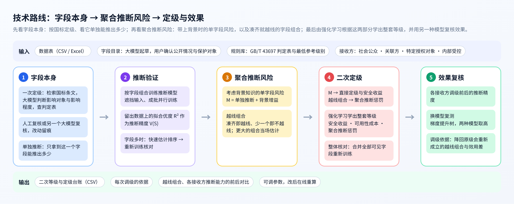

系统分为界面层、服务层、计算层和资源层（图 2-2）。界面层在浏览器中运行，导航按上述三组排列；服务层提供接口，管理任务与后台作业，并为计算选择设备；计算层包括流水线、定级引擎和推断引擎；资源层是大语言模型、规则库、数据与算力。

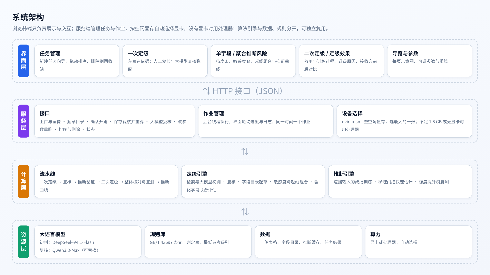

## 2.2 威胁模型与问题形式化

**数据与等级。** 设数据表有候选字段集合 H = {1, …, n} 和保护对象 y₁, …, y_m。保护对象是不应被无权者获取、需要防止被其他字段推断出来的数据。每个字段 i 有等级 aᵢ ∈ {1, 2, 3, 4}。参照 GB/T 43697 对一般数据共享范围的规定，设四类接收方：社会公众可获取 1 级数据，关联方可获取 2 级及以下，特定授权对象可获取 3 级及以下，内部受控范围可获取全部。在等级方案 a 下，接收方 c 能获取的候选字段为

$$\mathcal{V}_c(a) = \{\, i \in H : a_i \leq c \,\}$$

保护对象 y 的等级为 ℓ_y；当 ℓ_y > c 时，接收方 c 无权获取 y。

**威胁模型。** 接收方通过正常渠道获得其授权范围内的全部字段，并拥有同分布的历史样本，可以针对任意字段组合训练任意结构的推断模型。这是对接收方有利的保守假设，据此得到的是推断能力的上界刻画。本作品防御的是推断：不考虑接收方越权访问，也不考虑接收方之间合谋（合谋可视为一个权限更高的接收方）。

**推断精度。** 对保护对象 y 和字段组合 S ⊆ H，定义推断精度为接收方用 S 所能达到的最好预测效果。总体意义下

$$V^{*}(S) = 1 - \frac{\min_{f}\, \mathbb{E}\left[(y - f(x_S))^2\right]}{\mathrm{Var}(y)} = \frac{\mathrm{Var}(\mathbb{E}[y \mid x_S])}{\mathrm{Var}(y)}$$

它取值 0 至 1，0 表示 x_S 对 y 毫无信息，1 表示完全还原，并且对 S 单调不减：多给的字段可以忽略。实际中用有限样本估计：针对 S 训练推断模型 f_S，在未参与训练的留出数据上计算决定系数

$$V(S) = \max\left(0,\ 1 - \frac{\sum_{t \in \mathrm{test}} (y_t - f_S(x_{S,t}))^2}{\sum_{t \in \mathrm{test}} (y_t - \bar{y})^2}\right)$$

有限样本和优化误差会使 V 偶尔不单调。接收方拿到 S 后总可以只用其中一部分字段，所以取单调闭包作为风险对象：

$$\bar{V}(S) = \max_{T \subseteq S} V(T)$$

下文的 V 都指单调闭包。

**越线与最小越线组合。** 给接收方 c 设判定线 θ_c（默认社会公众 0.7，其他接收方 0.8）。若接收方 c 能凑齐组合 S（S ⊆ 𝒱_c(a)）、无权获取 y，且 V(S) > θ_c，则称 S 对 (c, y) 越线。若 S 越线而它的任何真子集都不越线，称 S 为最小越线组合。只要拆开全部最小越线组合，就拆开了全部越线组合。

**二次定级问题。** 在一次等级 L 的基础上只升不降地调整等级，使最小越线组合尽量被拆开，同时尽量少地缩小共享范围：

$$\max_{a}\ U(a) \quad \mathrm{s.t.}\quad L_i \leq a_i \leq 4,\ \ i \in H$$

其中综合效用 U 的具体形式在 2.6 节给出。这是一个离散组合优化问题，方案数为 4ⁿ 量级，而且每个最小越线组合都把若干字段的等级耦合在一起。

## 2.3 字段本身：一次定级与单独推断

### 2.3.1 一次定级

一次定级流程如图 2-3 所示。

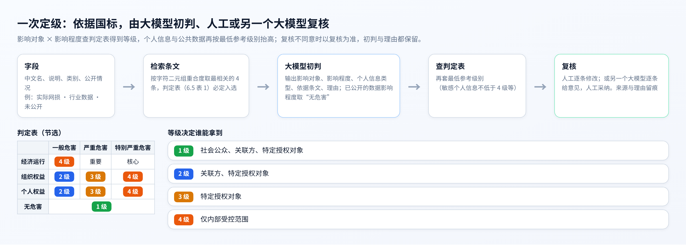

**规则库。** 从 GB/T 43697 中整理出 12 条与定级直接相关的条文（定级要素、判定表、一般数据分级、个人信息与公共数据的最低参考级别、衍生数据、动态更新等），以及判定表（影响对象 × 影响程度 → 等级）和最低参考级别（如敏感个人信息不低于 4 级、有条件开放的公共数据不低于 2 级）。

**检索。** 对每个字段，把中文名、说明和类别拼成查询，按字符二元组的重合度从规则库中取最相关的 4 条条文，判定表一条必定入选。设查询与条文的字符二元组集合分别为 Q 和 R，打分为 |Q ∩ R| / (√|R| + 1)。字符二元组检索不依赖分词和向量模型，结果稳定，便于审计。

**大模型初判。** 把检索到的条文和字段信息交给大语言模型（DeepSeek-V4.1-Flash，温度 0，结构化输出），只要求它判断两件事：数据一旦泄露，最主要的影响对象和影响程度；若属于个人信息，再判断是敏感还是一般个人信息。已对外公开的数据，影响程度取“无危害”。模型同时输出依据的条文编号和理由。

**查表得等级。** 等级不由大模型直接给出：

$$L_i = \max\left(\mathrm{Table}(o_i, d_i),\ \max_{k \in \mathcal{K}_i} \mathrm{Floor}(k)\right)$$

其中 oᵢ、dᵢ 为影响对象与影响程度，Table 为判定表，𝒦ᵢ 为字段适用的最低参考级别类别（个人信息类型、公共数据开放情况），Floor 为对应的最低级别。这样，大模型的判断可以逐项核对，等级的计算完全可复现。

**复核。** 人工可以逐条修改影响对象和影响程度，等级按判定表即时更新；也可以请另一个大模型（Qwen3.8-Max）逐条复核，它给出不同意见和理由，由人工逐条或全部采纳。复核意见记录来源与理由，与初判不一致的以复核为准，初判与理由都保留。

**字段目录起草。** 上传的数据表只有列名和数值。系统先逐列判断数值、类别、时间、文本四种类型，统计缺失与示例值，再请大模型起草每一列的中文名、说明、类别和公开情况，并建议哪些列可能是保护对象。公开情况和保护对象属于业务判断，必须由用户确认。

### 2.3.2 单独推断

一次定级看的是字段泄露本身的影响，单独推断看的是字段本身能推出什么：只拿到字段 i 一个时，对保护对象的推断精度 V({i})（测量方法见 2.4 节）。单字段判定线统一取 0.7，不分接收方。单独过线的字段几乎等同于保护对象本身，必须调高；但单独不过线并不等于安全，它可能在背景字段的配合下变得危险，这正是 2.5 节要处理的聚合推断风险。单独推断的精度也是 2.5 节字段推断风险 M 的起点（K = 0 的部分）。

## 2.4 推断精度的测量

推断验证的原理如图 2-4 所示。

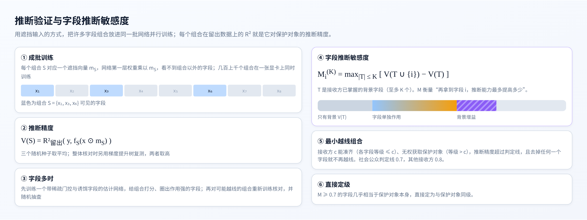

**遮挡输入的成批训练。** 若对每个字段组合单独训练一个模型，组合一多就无法承受。系统把一批组合 𝒮 放进同一个张量化的网络族中并行训练。每个组合 S 对应一个遮挡向量 m_S ∈ {0,1}^d，S 中字段对应的输入列为 1，其余为 0。组合 S 的网络第一层为

$$h_S^{(1)} = \mathrm{ReLU}\left((x \odot m_S)\, W_S^{(1)} + b_S^{(1)}\right)$$

使网络看不到组合以外的字段，后续层与普通全连接网络相同（两层隐藏层，宽 64 和 32）。所有组合的参数堆成张量，共同优化

$$\mathcal{L} = \sum_{S \in \mathcal{S}} \frac{1}{|D_{\mathrm{tr}}|} \sum_{t \in D_{\mathrm{tr}}} \left\Vert f_S(x_t \odot m_S) - y_t \right\Vert^2$$

由于各组合的参数互不共享，这等价于逐个训练，但一次前向与反向计算同时更新全部组合，一张显卡上可同时训练数百至上千个组合。数据按 8∶2 划分训练与留出，训练 80 轮；保护对象有多个分量时取各分量 V 的平均，类别型保护对象做独热编码；每个组合用 3 个随机种子训练取平均，最后做单调闭包。

**组合范围。** 候选字段不超过 8 个时训练全部组合；更多时训练不超过 3 个字段的全部组合。更大的组合有两条兜底：界面上可把组合最大字段数调大，由下文的快速估计网络当场打分、再挑估计值最高的重新训练核对（2.5.2 节）；定级完成后，2.6.4 节的整体核对再沿着接收方能拿到的全部字段逐步检查。

**字段较多时的快速估计。** 社区统计数据有 95 个候选字段，不超过 3 个字段的组合有十几万个。系统先训练一个快速估计网络 g(x, m)：训练时对每个样本随机抽取遮挡向量 m（多数样本只留很少几个字段），把遮挡后的输入和 m 本身一起送入网络，使同一个网络学会对任意可见集合给出预测；第一层权重采用分解式门控参数化

$$z = (x \odot m)\left(\Omega \odot \left(\prod_{l=1}^{D-1} \gamma^{(l)}\right) \mathbf{1}^{\top}\right) + W_m m$$

对 Ω 和各层 γ 施加平方惩罚。分解式参数化下，平方惩罚等价于对字段整体施加稀疏惩罚[17]，无关字段的门控会被压向 0。同时混入 30 个由真实字段随机打乱得到的诱饵字段，它们与保护对象无关；字段 i 的作用强度取 rᵢ = |∏ₗ γᵢ⁽ˡ⁾| · ‖Ωᵢ‖，强度不高于诱饵 90% 分位数的字段视为无关。训练完成后，任意组合 S 的估计精度只需一次前向计算。估计只用来筛选：在作用强的字段中对全部组合打分，对估计值接近或超过判定线的组合及其子集重新训练核对，并随机抽查 400 个组合检验是否漏掉。所有用于定级的推断精度都来自重新训练。

```
算法 1　推断验证（字段较多时）
输入：候选字段 H，保护对象 y，判定线 θ，组合规模上限 k
输出：已核对组合的推断精度表 V
1　训练快速估计网络 g，得到字段作用强度 r 与诱饵门槛 τ
2　H′ ← { i ∈ H : rᵢ > τ }，按 r 从大到小取前 45 个
3　对 H′ 中全部 |S| ≤ k 的组合计算估计值 Ṽ(S)
4　C ← { S : max Ṽ(S) ≥ θ − 0.15 } 中估计值最大的 2500 个
5　C ← C ∪ 全部单字段 ∪ C 中组合的全部子集 ∪ 随机抽取的 400 个组合
6　对 C 中组合成批重新训练（3 个随机种子），得到 V(S)
7　对 V 做单调闭包；统计随机抽查中“估计未越线、实际越线”的个数
```

## 2.5 聚合推断风险

聚合推断是本作品针对的威胁：接收方把能获取的多个字段合起来，推出无权获取的数据。它有两个视角。从字段看，一个字段配上接收方已有的背景会变得多危险（2.5.1 节）；从集合看，哪些字段凑齐就会越线（2.5.2 节）。前者决定字段自身是否需要调高，后者是二次定级要拆开的对象，两者的关系在 2.5.3 节说明。图 2-5 用同一组数据展示两个视角。

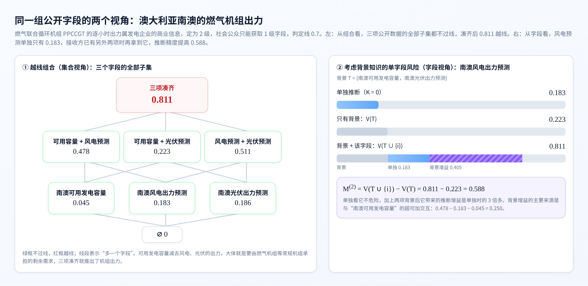

### 2.5.1 考虑背景知识的单字段风险

**定义。** 接收方往往已经掌握一些其他字段，称为背景。字段 i 对保护对象 y 的推断风险定义为：在至多 K 个背景字段的所有组合上，再加入字段 i 带来的最大推断增益

$$M_i^{(K)} = \max_{T \subseteq H \setminus \{i\},\ |T| \leq K} \left[\, V(T \cup \{i\}) - V(T) \,\right]$$

取到最大值的背景 T* 称为见证背景，它说明“这个字段与哪些字段一起开放最危险”。M 对 K 单调不减；K 取到 |H| − 1 时，M 就是最大边际贡献（MCI）[14]。

**分解：单独推断与背景增益。** 记 aᵢ = V({i}) = Mᵢ⁽⁰⁾ 为单独推断的精度，则

$$M_i^{(K)} = a_i + \Gamma_i^{(K)}, \qquad \Gamma_i^{(K)} = M_i^{(K)} - M_i^{(0)} \geq 0$$

Γ 称为背景增益，度量“有了背景之后，这个字段的作用被放大了多少”，也就是字段之间的协同。K = 1 时可以写出闭式：

$$M_i^{(1)} = a_i + \max\left(0,\ \max_{j \neq i} I_{ij}\right), \qquad I_{ij} = V(\{i,j\}) - V(\{i\}) - V(\{j\}) + V(\varnothing)$$

即背景增益来自字段与某个伙伴的超可加交互 Iᵢⱼ > 0：两个字段合起来的推断能力大于各自之和。图 2-5 右：南澳风电出力预测单独只有 0.183；接收方已有可用发电容量和光伏预测（两者合起来 0.223）时再拿到它，推断精度升到 0.811，M⁽²⁾ = 0.588，其中背景增益 0.405。增益主要来自它与可用发电容量的交互：0.478 − 0.183 − 0.045 = 0.250。只看单独推断，就会严重低估这个字段的危险。

**背景预算 K 的含义。** 定义中的最大值取遍所有不超过 K 个字段的背景，这不是说接收方掌握了全部字段、只用其中 K 个，而是说审查方并不知道某个接收方手里已经有哪些字段：不同接收方掌握的公开数据各不相同，K 限定了与字段 i 组合使用的背景字段数。这与电力系统运行中的 N−k 安全准则、针对至多 k 条背景知识的隐私保护[21]、鲁棒优化中的不确定性预算[22]是同一种思路：在规模有限的不确定集合上考虑最坏情况。若要求对任意规模的背景都安全，结论会过于保守，几乎所有字段都要上调。

K 为什么可以取得较小，可以从边际递减来理解。信息的边际价值通常随已知信息的增多而递减：已经知道的越多，再多知道一个字段，带来的新信息往往越少。若 V 满足这种边际递减（即次模性），任何背景都不会放大字段的作用，Mᵢ⁽ᴷ⁾ = Mᵢ⁽⁰⁾，只看单独推断就已足够。实际数据介于两者之间：多数字段彼此冗余，边际递减；少数字段相互补充，产生背景增益。只有与字段 i 存在正交互的字段（称为它的“放大字段”）才会抬高 i 的 M，其余字段放进背景只会降低 i 的边际，因此 K 只需覆盖放大字段的个数。实测中 M 随 K 的增量迅速减小（表 3-6）。

**K 的自动选定。** 各数据的字段数和关联结构不同，背景增益饱和的快慢也不同，所以 K 不固定，由系统在 2 和 3 之间选定。取每个保护对象 M⁽²⁾ 最大的 10 个字段，先看 K 从 1 加到 2 时它们的 M 平均还增加多少：不到 0.01，说明背景增益已经饱和，取 K = 2，不再计算。否则试算 K = 3：字段不超过 8 个时全部组合都已重新训练，直接精确计算；字段更多时，在每个字段 K = 2 的最危险背景上逐个加入一个候选字段（取 M⁽²⁾ 最大的 20 个），重新训练这些 3 字段背景及其加上该字段后的组合。若 M 平均再增加不少于 0.01，或有字段再增加不少于 0.05，说明背景增益还没有饱和，取 K = 3，否则取 K = 2。数据主管方也可以在参数中把 K 固定为某个值。7 个任务中只有 NEM 选定 K = 3（3.7 节）。

**在定级中的作用。** M 达到直接定级线的字段直接定为与保护对象同级；其余字段的 M 进入二次定级综合效用中的安全收益：M 越大，留在低等级扣分越多（2.6 节）。

### 2.5.2 越线组合

**定义。** 若接收方 c 能凑齐组合 S（S 中各字段等级都不高于 c）、无权获取保护对象 y，且 V(S) 超过判定线 θ_c，则称 S 对 (c, y) 越线；去掉其中任何一个字段都不再越线的组合称为最小越线组合。只要接收方凑不齐其中任何一个字段，组合就被拆开。图 2-5 左是一个最小越线组合的全部子集：单个字段 0.045、0.183、0.186，两两组合 0.478、0.223、0.511，都不过线，三项凑齐 0.811 越线。

**组合规模与当场估计。** 推断验证对不超过 3 个字段的组合逐个重新训练（字段不超过 8 个时训练全部组合），由此得到的最小越线组合直接用于二次定级。选定 K = 3 时，试算 K = 3 所重新训练的 4 字段组合中的最小越线组合也直接用于二次定级。接收方也可能把更多字段凑在一起，所以界面上可以选择“组合最大字段数”（默认取 K + 1，即一个字段加上至多 K 个背景字段；可选 2 到 6）。选择更大的规模时，系统用 2.4 节的估计器当场计算：

```
算法 2　更大规模的最小越线组合（当场估计）
输入：保护对象 y，最大规模 k，判定线 θ_c，一次等级 L，已重新训练的推断精度表
输出：估计的最小越线组合，其中估计值最高的若干个已重新训练核对
1　读取或训练该任务的估计网络 g（每个任务只训练一次并缓存）
2　按门控强度圈出作用较强的字段（最多 22 个）
3　对圈定字段中规模不超过 k 的全部组合打分；已重新训练过的组合用真实值
4　对全部组合做单调闭包
5　对每类接收方 c：在其能凑齐的组合中，找出估计值超过 θ_c、且去掉任一字段即不超过的组合
6　按估计值从高到低取前 20 个新组合，成批重新训练核对，标注“估计、已核对”
7　标注每个组合在二次等级下是否仍能凑齐
```

PJM 数据上，估计器在 28 秒内对 9109 个组合打分，找到 1 个 4 字段的越线组合，估计 0.708，重新训练核对为 0.729，确认越线。这些更大的组合在二次定级中由整体核对兜底（2.6.4 节）。

**在定级中的作用。** 最小越线组合进入二次定级综合效用中的聚合推断惩罚：调级后仍能凑齐的组合，按超出判定线的幅度扣分。

### 2.5.3 两个视角的关系

M 是字段视角的量，越线组合是集合视角的量，两者描述的是同一种风险。设 V 单调且 V(∅) = 0，它们之间有三条关系（图 2-6，证明见附录 B）：

（1）**组合受成员 M 之和约束。** 对任意规模不超过 K + 1 的组合 A，V(A) − V(∅) ≤ Σ_{i∈A} Mᵢ⁽ᴷ⁾。成员 M 都很小的组合不可能越线。

（2）**关键字段当且仅当属于最小越线组合。** 字段 i 能把某个不越线的、不超过 K 个字段的背景推过判定线，当且仅当它属于某个规模不超过 K + 1 的最小越线组合。

（3）**组合的不可约增益不超过成员的 M。** 对规模不小于 2 的组合 E，V(E) − max_{E′⊂E} V(E′) ≤ min_{j∈E} Mⱼ⁽|ᴱ|⁻¹⁾。强协同组合的每个成员都有较大的 M。

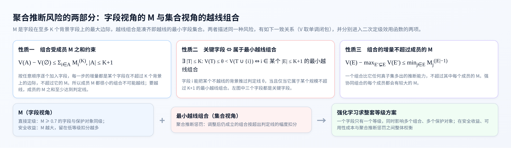

这说明两个视角是一致的，但分工不同：M 给出每个字段的“最坏情况风险”，适合决定字段自身是否需要调高；越线组合指出具体哪些字段不能同时开放给同一类接收方，适合作为整套方案的约束。一个字段只有一个等级，却同时出现在多个组合、影响多个保护对象，所以拆开哪个组合最划算，要在整套方案上权衡，这由 2.6 节的强化学习完成。

## 2.6 二次定级

二次定级的输入是 2.5 节的两部分风险：字段推断风险 M 进入直接定级与安全收益，最小越线组合进入聚合推断惩罚。二次定级分三步：直接定级、联合评估和整体核对（图 2-7）。

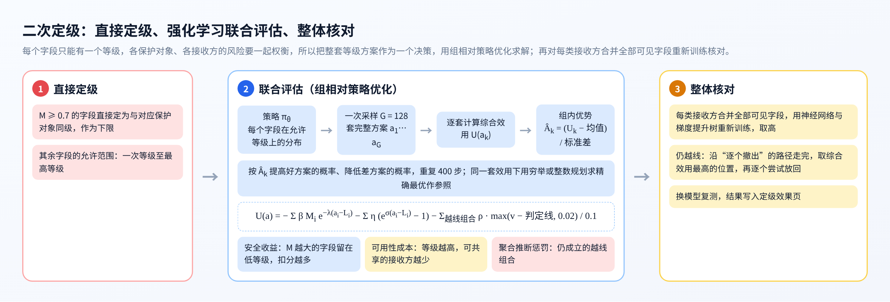

### 2.6.1 直接定级

若字段 i 对某个保护对象 y 的字段推断风险 Mᵢ⁽ᴷ⁾ ≥ δ（直接定级线，默认 0.7），说明接收方只要再有不超过 K 个背景字段，加上它就能把 y 推到相当高的精度，它几乎相当于 y 本身。这类字段直接定为与 y 同级，作为该字段等级的下限：

$$a_i^{\min} = \max\left(L_i,\ \max_{y:\ M_{i,y}^{(K)} \geq \delta} \ell_y\right)$$

其余字段的允许范围为 [aᵢᵐⁱⁿ, 4]。

### 2.6.2 综合效用

记 Δᵢ = aᵢ − Lᵢ 为字段 i 相对一次等级上调的级数，M̂ᵢ = max_y Mᵢ,y 为字段对各保护对象的字段推断风险最大值，wᵢ 为字段的使用价值权重（默认均为 1）。综合效用为

$$U(a) = -\sum_i \beta \hat{M}_i e^{-\lambda \Delta_i} - \sum_i \eta\, w_i \left(e^{\sigma \Delta_i} - 1\right) - \sum_{(c,y,S) \in \mathcal{A}(a)} \rho \cdot \frac{\max(V_y(S) - \theta_c,\ 0.02)}{0.1}$$

三项都是扣分，U 越接近 0 越好：

（1）**安全收益。** 字段留在原级时剩余风险为 βM̂ᵢ，每上调一级，剩余风险乘以 e^(−λ)：等级越高，能拿到它的接收方越少，背景也越难凑齐。M 越大的字段，留在低等级扣分越多。

（2）**可用性成本。** 每上调一级，共享范围缩小一类接收方，成本按 e^(σΔᵢ) − 1 增长：连续上调多级的代价越来越大，避免为了安全把字段一律定到最高级。

（3）**聚合推断惩罚。** 𝒜(a) 为在方案 a 下仍然成立的最小越线组合：接收方 c 能凑齐 S 中全部字段（S ⊆ 𝒱_c(a)）、且无权获取 y。每个组合按其推断精度超出判定线的幅度扣分，刚过线的也至少按 0.02 计。远超判定线的组合扣分重，刚过线的扣分轻。

默认 β = 2.5，λ = 1，η = 1，σ = 0.5，ρ = 2，均可在界面上修改后重算。前两项对每个字段独立，第三项把同一组合中的字段耦合在一起，这正是问题难以逐字段求解的原因。

### 2.6.3 组相对策略优化求解

**建模为单步决策。** 把“为全部字段定级”看作一个单步决策问题：状态是全部字段的特征，动作是整套等级方案 a，回报是综合效用 U(a)。目标是找到使期望回报最大的随机策略 π_θ。

**策略参数化。** 每个字段 i 有 5 维特征 sᵢ：一次等级、等级下限、M̂ᵢ、所在越线组合的罚分占比、权重。共享网络 f_θ（5 → 64 → 64 → 4，tanh 激活）输出各等级的得分，再加上每个字段自己的偏置 bᵢ，在允许范围外的等级屏蔽掉（图 2-8）：

$$\pi_\theta(a_i = l \mid s_i) = \frac{\exp\left(f_\theta(s_i)_l + b_{i,l}\right)}{\sum_{l'=a_i^{\min}}^{4} \exp\left(f_\theta(s_i)_{l'} + b_{i,l'}\right)}, \qquad \pi_\theta(a) = \prod_{i \in H} \pi_\theta(a_i \mid s_i)$$

共享网络让 M 大、罚分占比高的字段倾向于上调，字段偏置给每个字段留出单独调整的自由度。

**组相对优势与更新。** 每一步从策略中独立采样 G 套完整方案 a₁, …, a_G，逐套计算 U(a_k)，以组内标准化的效用作为优势：

$$\hat{A}_k = \frac{U(a_k) - \mathrm{mean}_{j}\, U(a_j)}{\mathrm{std}_{j}\, U(a_j)}$$

按策略梯度[18]更新参数，损失为

$$\mathcal{L}(\theta) = -\frac{1}{G} \sum_{k=1}^{G} \hat{A}_k \log \pi_\theta(a_k) - \gamma_t\, \mathcal{H}(\pi_\theta)$$

其中 ℋ 为各字段等级分布的平均熵，γ_t = 0.2(1 − t/T) 随训练步线性减小，前期鼓励探索、后期收敛。组内比较代替了价值网络：同一组方案面对的是同一个定级任务，用组内均值作为基线即可得到低方差的优势估计[20]。默认 G = 128，T = 400 步，学习率 3 × 10⁻³。训练中记录出现过的最好方案，训练结束后再取策略的众数方案，两者取效用较高者。

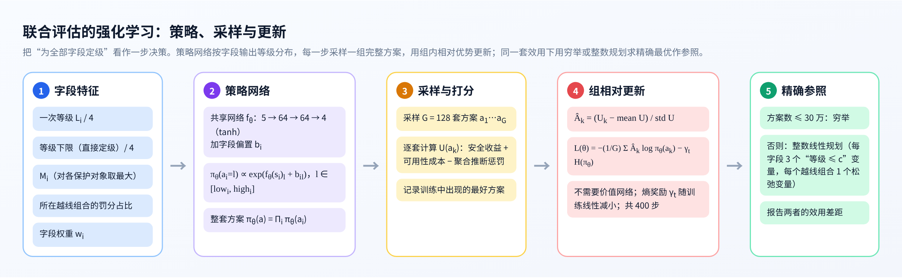

```
算法 3　联合评估（组相对策略优化）
输入：一次等级 L，等级下限 aᵐⁱⁿ，字段推断风险 M̂，最小越线组合及罚分，参数 β, λ, η, σ, ρ, G, T
输出：等级方案 a*
1　按 2.6.2 节预先计算每个字段在各等级下的安全收益与可用性成本
2　初始化共享网络 f_θ 与字段偏置 b；best ← −∞
3　for t = 1 … T：
4　    计算各字段在允许等级上的分布 π_θ(· | sᵢ)
5　    独立采样 G 套方案 a₁ … a_G，逐套计算 U(a_k)（聚合推断惩罚按组合是否仍成立一次性批量计算）
6　    若 max U(a_k) > best，记录该方案
7　    Â_k ← (U(a_k) − 均值) / 标准差
8　    θ, b ← θ, b − ∇[ −(1/G)Σ Â_k log π_θ(a_k) − γ_t ℋ(π_θ) ]（Adam）
9　取策略众数方案；返回它与记录中最好方案里效用较高的一个
```

**精确参照。** 为检验强化学习的结果，在同一套效用下求精确最优。允许方案数不超过 30 万时直接穷举；否则写成整数线性规划。对字段 i 和接收方等级 c ∈ {1, 2, 3} 引入 0-1 变量 u_{i,c}，表示“aᵢ ≤ c”，则 aᵢ = 4 − Σ_c u_{i,c}，并要求 u_{i,1} ≤ u_{i,2} ≤ u_{i,3}。由于每个字段的效用只取决于其等级，可写成 u 的线性函数。对每个最小越线组合 (c, y, S) 引入松弛变量 ξ ∈ {0,1}，表示它仍然成立：

$$\max\ \sum_i \left[F_i(4) + \sum_{c=1}^{3} u_{i,c}\left(F_i(c) - F_i(c+1)\right)\right] - \sum_{(c,y,S)} w_{c,y,S}\, \xi_{c,y,S}$$

$$\mathrm{s.t.}\quad \sum_{i \in S} u_{i,c} \leq |S| - 1 + \xi_{c,y,S}, \qquad u_{i,c} \leq u_{i,c+1}$$

其中 Fᵢ(l) 为字段 i 定为 l 级时的安全收益与可用性成本之和，w 为该组合的罚分。约束的含义是：S 中字段若全部对 c 可见，则该组合成立，必须付出罚分。

强化学习不依赖问题的线性结构。整体核对时效用中会加入“整体推断惩罚”，它由重新训练得到，不能写成线性约束，整数规划不再适用，而强化学习仍可直接使用。这是本作品采用强化学习作为主求解方法、以精确解作参照的原因。

### 2.6.4 整体核对

越线组合只覆盖了不超过 3 个字段的组合。为防止“更多字段合起来”仍然越线，对每类接收方 c，用它在新等级下能获取的全部字段重新训练神经网络和梯度提升树，取两者中较高的推断精度：

$$W_c(a) = \max_{y:\ \ell_y > c}\ \max\left(V^{\mathrm{NN}}_y(\mathcal{V}_c(a)),\ V^{\mathrm{GBT}}_y(\mathcal{V}_c(a))\right)$$

若仍超过判定线，就逐个撤出字段（把它调到 c + 1 级），并在效用中加入整体推断惩罚 ρ_w · Σ_y max(V_y − θ_c, 0)/0.1。

```
算法 4　整体核对（接收方 c）
输入：联合评估得到的方案 a，判定线 θ_c，快速估计网络 g
输出：调整后的方案 a
1　重新训练，计算当前全部可见字段的推断精度与整体推断惩罚 P₀
2　路径 ← [(代价 0, 惩罚 P₀)]
3　while 仍有保护对象越线且可见字段多于 1 个：
4　    用 g 估计撤出每个可见字段后的推断精度，按“估计惩罚 + 上调代价”排序取前 6 个
5　    对这 6 个候选重新训练，撤出“真实惩罚 + 上调代价”最小的字段 j，记入路径
6　在整条路径上取“累计上调代价 + 整体推断惩罚”最小的位置，其后的撤出撤销
7　按撤出的逆序逐个尝试放回：若放回节省的代价大于惩罚的增加，则放回
```

默认不要求严格消除所有越线，而是按综合效用取舍；开启严格模式后，会一直撤出到不再越线。

## 2.7 效果复核与调级依据

**换模型复测。** 用没有参与定级的直方图梯度提升树，对每类接收方在调级前后能获取的全部字段，重新测一遍对每个保护对象的推断精度，与神经网络的结果并列，任一模型超过判定线即视为越线。

**调级依据。** 对每个调高的字段，系统给出：直接定级时的 M、见证背景及对应保护对象；联合评估时“其他字段不动、只改这个字段的等级”在各等级下的整套方案效用，以及保持原级与现等级之间安全收益、可用性成本、聚合推断惩罚各自的变化；降回原级会重新成立的越线组合。

**仅凭公开数据即可推出的情形。** 若某保护对象仅凭所有接收方都已掌握的数据就能推出，调整候选字段的等级不起作用，系统单独标出，交由数据主管方另行处理。

## 2.8 系统实现

**技术栈。** 服务端用 Python 标准库实现 HTTP 服务，推断与优化用 PyTorch，换模型复测用 scikit-learn，整数规划用 SciPy；界面为原生 JavaScript 与 ECharts，不依赖外部网络资源。没有安装深度学习库时以演示方式运行，只查看内置结果。

**设备选择。** 通过 nvidia-smi 查询每张显卡的空闲显存，选择空闲最多的一张；都不足 1.8 GB 或没有显卡时使用处理器。查询不在进程内建立显卡上下文，避免在共享服务器上额外占用显存。

**后台作业。** 新建任务的流水线依次执行一次定级、复核、推断验证、二次定级、整体核对与复测、推断曲线；进度和日志写入文件，界面每 2 秒刷新，关闭页面不影响运行。

**大模型调用。** 起草目录、一次定级、复核三处调用统一封装：失败时在“经代理”和“直连”两种连接方式之间切换重试；密钥写在单独的配置文件中，不进入代码。

**界面。** 导航按三组排列：字段本身（一次定级、单独推断）、聚合推断风险（考虑背景知识的单字段风险、越线组合）、定级与效果（二次定级、定级效果）。图 2-9 至图 2-16 以 NEM 数据、保护对象“PPCCGT 机组出力”为例。


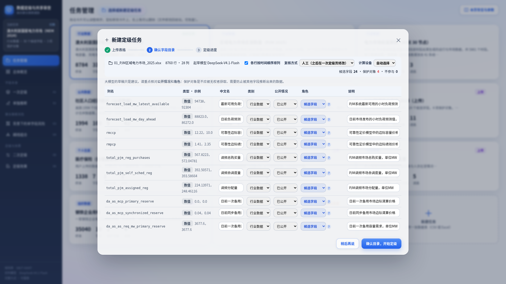


## 2.9 功能与指标

表 2-1 主要功能

| 分组 | 功能 | 说明 |
|---|---|---|
| 任务 | 新建任务 | 上传 CSV 或 Excel；逐列画像；大模型起草字段目录；用户确认公开情况、保护对象、时间序列、复核方式与计算设备 |
| 字段本身 | 一次定级 | 检索国标条文，大模型初判影响对象与影响程度，查判定表与最低参考级别 |
|  | 复核 | 人工逐条修改；或另一个大模型复核，意见可逐条或全部采纳；保存后自动重算 |
|  | 单独推断 | 每个字段单独推断保护对象的精度，单字段判定线 0.7 |
| 聚合推断风险 | 考虑背景知识的单字段风险 | M = 单独推断 + 背景增益，K 可调；与哪些字段一起开放最危险 |
|  | 越线组合 | 最小越线组合、子集格子图、成员字段的 M；组合最大字段数可选，更大的组合当场估计并重训核对 |
| 定级与效果 | 二次定级 | 直接定级；强化学习联合评估与精确参照；整体核对；可只保护某一项保护对象另算 |
|  | 定级效果 | 各接收方调级前后的推断精度；换模型复测；调级依据；定级台账导出 |
| 通用 | 参数调整 | 判定线、直接定级线、K、效用系数、训练步数与组大小、严格模式，改后在线重算 |
|  | 任务管理 | 拖动排序；删除到回收站，可恢复 |

表 2-2 主要指标（测试结果见第三章）

| 指标 | 结果 |
|---|---|
| 支持的数据 | 数值、类别字段；时间与文本字段自动排除；单表 50 行以上 |
| 推断验证规模 | 单个任务重新训练核对 32 至 4527 个字段组合；95 个候选字段时快速估计 15276 个组合用时 0.8 秒 |
| 当场估计更大组合 | 规模不超过 4 的组合约 9000 个，30 秒内完成打分与核对 |
| 越线组合 | 7 个任务合计由 2028 个降至 11 个 |
| 强化学习的最优性 | 7 个任务中 6 个与精确最优相同，1 个相差 0.4% |
| 理论关系 | M 与越线组合的三条关系在 4.2 万余个配对上无违例 |
| 全流程用时 | 上传测试任务在显卡上 3 至 10 分钟；小数据在处理器上 37 秒 |
| 运行环境 | 有无显卡均可；无深度学习库时以演示方式查看结果 |

# 第三章 作品测试与分析

## 3.1 测试方案

测试按系统的三组展开：（1）字段本身：一次定级与复核是否可靠；（2）聚合推断风险：M 能否反映背景增益，越线组合能否找全，两个视角是否一致；（3）定级与效果：二次定级能否拆开越线组合、降低各接收方的推断能力，强化学习离精确最优有多远。最后检验从上传数据表开始的全流程能否在不同设备上运行。

## 3.2 测试环境

表 3-1 测试环境

| 项目 | 配置 |
|---|---|
| 处理器 | Intel Xeon Platinum 8380，160 线程 |
| 内存 | 251 GB |
| 显卡 | NVIDIA GeForce RTX 4090（24 GB）× 4，测试中最多并行使用 3 张 |
| 软件 | Python 3.10，PyTorch 2.5.1，scikit-learn 1.7.2，pandas 2.3.3，SciPy |
| 大语言模型 | 初判与起草目录：DeepSeek-V4.1-Flash；复核：Qwen3.8-Max |
| 界面测试 | Chromium 浏览器自动化，逐页截图检查脚本错误 |

## 3.3 测试数据

测试使用 7 个公开数据集（表 3-2），覆盖电力市场实测、电力仿真、公共统计、个人信息、企业用能和楼宇传感器。保护对象是为测试设定的“未公开数据”，其余字段按实际情况设定公开情况。

表 3-2 测试数据集

| 数据集 | 样本数 | 候选字段 | 保护对象（一次等级） | 来源 |
|---|---|---|---|---|
| NEM 2024 | 8784 | 30 | 燃煤、水电、燃气 3 台机组的出力（均为 2） | 澳大利亚能源市场运营机构公开数据[23] |
| PJM 2025 | 8760 | 24 | 实际网损（2）、发电总出力（4）、实际总交换功率（4）、联络线净交换功率（4） | PJM 公开数据[24] |
| IEEE 30 节点 | 5881 | 8 类 | 线路潮流（4）、节点相角（4）、机组报价（3） | 在 IEEE 30 节点标准算例[25]上按直流最优潮流逐时段出清生成 |
| 社区统计 | 1994 | 95 | 贫困人口比例等 5 项（均为 4） | UCI 社区与犯罪数据集[26] |
| 医疗保险 | 1338 | 6 | 医疗费用（4） | 公开教学数据[27] |
| 钢铁企业用电 | 35040 | 8 | 用电量（3）、负荷类型（3） | UCI 钢铁企业用电数据集[28] |
| 楼宇人员在室 | 20560 | 5 | 是否有人（3） | UCI 楼宇人员在室数据集[29] |

NEM 数据取 5 个地区的实际需求、可用发电容量、风电与光伏出力预测、出清电价，以及 6 条区域间联络线潮流，均为按规定公开的数据。PJM 数据另以 Excel 形式、钢铁企业用电与楼宇人员在室数据以 CSV 形式，通过界面上传、走完了新建任务的全流程。

## 3.4 字段本身：一次定级与复核

7 个任务共 195 个字段由大模型初判，人工复核调整 19 个（9.7%）。NEM 的 33 个字段初判全部合理：30 个公开字段为“无危害”1 级，3 台机组出力为“组织权益·一般危害”2 级，未作调整。其他任务的调整主要有两类：

（1）**影响对象判错。** 例如 PJM 的实际网损被判为“经济运行”，按判定表会成为 4 级；复核认为它反映的是电网企业自身的运行经济性，改为“组织权益”，定为 2 级。钢铁企业的用电量被判为“个人权益”，复核改为“组织权益”。

（2）**危害程度偏低。** 大模型倾向于把保护对象判为“一般危害”，与候选字段同为 2 级，这样能拿到候选字段的接收方本就有权获取保护对象，不存在越权推断。复核按数据的实际敏感程度调整，例如逐分钟的在室记录反映个人行踪，改为“严重危害”（3 级）。

另用 Qwen3.8-Max 对医疗保险任务的 7 个字段做大模型复核，它同意 6 条初判，对“医疗费用”提出应为“严重危害”的意见；该字段按敏感个人信息的最低参考级别本就是 4 级，等级不变。

字段目录起草方面，大模型对列名的解读基本可用，但公开情况与保护对象的建议偏差较大：对 PJM 的 28 列全部建议“已公开”、不设保护对象，对医疗保险的 7 列则全部建议为保护对象。这说明公开情况和保护对象必须由用户确认，系统在界面上也是这样设计的。

**单独推断。** NEM 中没有任何字段单独推断机组出力超过 0.7：对燃气机组 PPCCGT，单独推断最强的是南澳出清价（0.578），风电预测只有 0.183。只看字段本身，这 30 个字段都可以向社会公众开放。

## 3.5 典型案例：澳大利亚 NEM 的燃气机组出力

本案例以燃气联合循环机组 PPCCGT 的出力为主线，按系统的三组页面依次展开。

**聚合推断风险之一：考虑背景知识的单字段风险。** 系统先选定背景预算：K 从 1 加到 2 时，风险靠前字段的 M 平均还增加 0.030，没有饱和；试算 K = 3，平均再增加 0.009，但新南威尔士可用发电容量对水电机组 TUMUT3 的 M 由 0.164 增至 0.269（背景为新南威尔士实际需求、维多利亚出清价和 VIC1-NSW1 联络线潮流），超过 0.05，于是取 K = 3。NEM 有 30 个候选字段，跨 5 个地区和 6 条联络线，推断链条比其他数据长，这是它需要更大 K 的原因。对 PPCCGT，背景增益最大的字段是南澳风电出力预测：单独 0.183，K = 1 时 M = 0.433（背景为南澳可用发电容量），K = 2 时 M = 0.588（背景为可用发电容量与光伏预测），K = 3 时不再增加；背景增益 0.405，是单独作用的两倍多（图 2-13）。其次是南澳可用发电容量，单独只有 0.045，K = 2 时 M = 0.364。这两个字段单独看几乎无害，在系统的总览图中却排在前列，紫色斜纹（背景增益）占了大部分。

**聚合推断风险之二：越线组合。** PPCCGT 共有 13 个最小越线组合，3 个字段的 8 个、4 个字段的 5 个，都对社会公众越线（图 2-14）；另有 1 个对燃煤机组 BW01 的 4 字段组合。南澳风电预测出现在 PPCCGT 的全部 13 个组合中，南澳可用发电容量出现在 10 个中，与它们的 M 排在前列一致。精度最高的是“可用发电容量 + 风电预测 + 光伏预测”（0.811），其全部子集都不过线。4 字段组合来自试算 K = 3 时重新训练的组合，例如“维多利亚实际需求 + 新南威尔士可用发电容量 + 南澳可用发电容量 + 南澳风电预测”为 0.725，其中任意 3 个都不过线。组合最大字段数默认为 K + 1 = 4，此时估计器对圈定字段的 9109 个组合打分，没有找到其他 4 字段越线组合，估计与重新训练的平均误差为 0.045。

**定级与效果。** 二次定级调高了 17 个字段（联合评估 9 个、整体核对 8 个），没有字段达到直接定级线。14 个越线组合全部拆开，强化学习的结果与整数规划求得的精确最优相同（−23.64）。以南澳风电出力预测为例（图 2-15），若保持 1 级，整套方案的综合效用为 −30.17；调到 2 级后为 −23.64，提高 6.53，其中聚合推断惩罚减少 6.25、安全收益增加 0.93，可用性成本增加 0.65；若降回 1 级，会有 6 个越线组合重新成立。

表 3-3 NEM 的调级结果（节选）

| 字段 | 一次 → 二次 | 方式 | 依据 |
|---|---|---|---|
| 南澳风电出力预测 | 1 → 2 | 联合评估 | 对 PPCCGT 的 M = 0.588；效用提高 6.53；降回 1 级重新成立 6 个越线组合 |
| 南澳出清价 | 1 → 2 | 联合评估 | 对 PPCCGT 的 M = 0.578 |
| 南澳可用发电容量 | 1 → 2 | 整体核对 | 出现在 10 个越线组合中，对 PPCCGT 的 M = 0.364 |
| 南澳光伏出力预测 | 1 → 2 | 整体核对 | 对 PPCCGT 的 M = 0.379 |

图 3-1 是社会公众合并全部可获取字段后的推断精度。整体核对后，社会公众能获取的字段由 30 个减到 13 个，对燃煤机组 BW01 的推断精度由 0.825 降至 0.637，对水电机组 TUMUT3 由 0.767 降至 0.409，均降到判定线以下；对燃气机组 PPCCGT 由 0.897 降至 0.726，仍略高于判定线。燃气机组承担剩余负荷，几乎所有地区的需求、出清价和新能源预测都携带它的信息，若要压到线下，需要把大部分字段调到 2 级，社会公众几乎拿不到电力市场的公开数据，信息披露的目的也就落空了。当前结果是按综合效用在安全与开放之间求得的平衡；数据主管方可以调高聚合推断惩罚 ρ 或整体推断惩罚 ρ_w、降低可用性成本系数 η，或开启严格模式，进一步降低风险，但要保证数据的开放性和可用性，不能为了消除全部推断风险而不开放。系统把剩余风险如实列在定级效果页，供数据主管方决定。

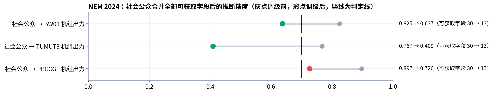

## 3.6 七个数据集的总体结果

表 3-4 二次定级结果

| 数据集 | 最小越线组合 | 调高字段（直接 / 联合 / 核对） | 越线的“接收方×保护对象” | 联合评估与精确最优 |
|---|---|---|---|---|
| NEM 2024 | 14 → 0 | 17（0 / 9 / 8） | 3 → 1 | −23.64 / −23.64（整数规划） |
| PJM 2025 | 15 → 0 | 11（2 / 8 / 1） | 7 → 5 | −21.81 / −21.81（整数规划） |
| IEEE 30 节点 | 10 → 0 | 3（1 / 2 / 0） | 5 → 0 | −7.92 / −7.92（穷举） |
| 社区统计 | 1982 → 11 | 42（12 / 30 / 0） | 13 → 11 | −101.52 / −101.10（整数规划） |
| 医疗保险 | 2 → 0 | 1（1 / 0 / 0） | 2 → 0 | −2.70 / −2.70（穷举） |
| 钢铁企业用电 | 4 → 0 | 4（2 / 2 / 0） | 1 → 0 | −7.66 / −7.66（穷举） |
| 楼宇人员在室 | 1 → 0 | 5（1 / 4 / 0） | 1 → 0 | −5.90 / −5.90（穷举） |

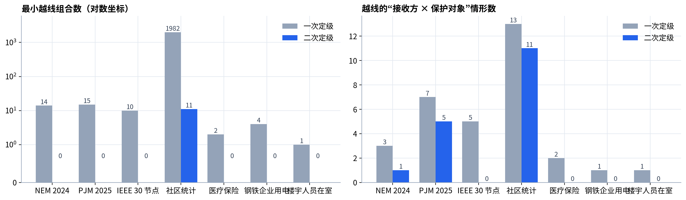

7 个任务的最小越线组合合计由 2028 个降至 11 个，其中 6 个任务全部拆开；越线的“接收方×保护对象”情形由 32 个降至 17 个，IEEE 30 节点、医疗保险、钢铁企业用电和楼宇人员在室四个任务全部消除。NEM、PJM 和社区统计仍有剩余，原因相同：保护对象与大量公开字段高度相关。社区统计的越线组合多达近两千个，整体核对把社会公众的推断精度由 0.900 降至 0.863，仍在判定线之上；PJM 的发电总出力与负荷、价格类字段高度相关。若要求严格不越线，需要把大部分字段调到高等级，数据的可用性和开放程度会大幅下降。当前结果按综合效用权衡得出，保留了大部分字段的开放；业务上更看重安全时，可调整效用系数或开启严格模式进一步降低风险。

## 3.7 方法有效性

**两个视角的一致性。** 在 NEM、PJM、IEEE 30 节点和社区统计的全部已核对组合上（K = 2，判定线 0.7），逐一检验 2.5.3 节的三条关系：关系一检查 42187 个“组合 × 保护对象”配对，关系三检查 41502 个，无一违例；关系二对 685 个“字段 × 保护对象”逐一判断“是否关键字段”与“是否属于规模不超过 3 的最小越线组合”，两者完全一致。

**背景预算 K 的饱和与选定。** 表 3-6 是每个保护对象 M 最大的 10 个字段的平均 M 随 K 增大的增量，也就是 2.5.1 节选定 K 所用的统计。从 K = 0 到 K = 1，平均增加 0.034 至 0.079，个别字段增加近 0.4（社区统计中“人均收入”在有“白人人均收入”作背景时）；从 K = 1 到 K = 2，除 NEM 外都不超过 0.009。PJM 与社区统计在 K 从 1 到 2 时已饱和，直接取 K = 2；IEEE 30 节点与医疗保险精确计算到 K = 3，增量都在 0.002 以内，也取 K = 2。NEM 的增量下降较慢：K 从 1 到 2 平均仍增加 0.030；试算 K = 3 时平均再增加 0.009，个别字段增加 0.105，因此取 K = 3。这与 NEM 字段多、跨地区的推断链条长相符，也与它出现 4 字段越线组合相符。钢铁企业用电与楼宇人员在室两个上传任务同样选定 K = 2。

表 3-6 字段推断风险随 K 的增量与 K 的选定

| 数据集 | K = 0→1 | K = 1→2 | K = 2→3（平均，最大） | 选定 K |
|---|---|---|---|---|
| NEM 2024 | 0.073 | 0.030 | 0.009，0.105（试算） | 3 |
| PJM 2025 | 0.079 | 0.009 | 已饱和，未试算 | 2 |
| IEEE 30 节点 | 0.037 | 0.005 | 0.001，0.012（精确） | 2 |
| 社区统计 | 0.034 | 0.000 | 已饱和，未试算 | 2 |
| 医疗保险 | 0.039 | 0.006 | 0.000，0.000（精确） | 2 |

**强化学习与精确最优。** 图 3-3 比较了只做一次定级、联合评估和精确最优三种方案的综合效用。联合评估在 6 个任务上与精确最优完全相同；社区统计相差 0.4%。图 3-4 是 NEM 与社区统计的训练过程。

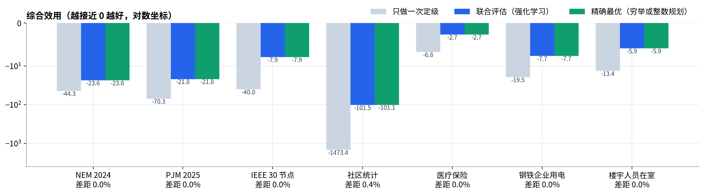

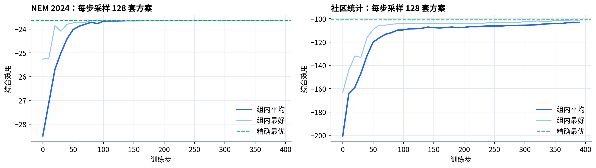

**估计器的作用。** 社区统计有 95 个候选字段，估计网络圈出作用较强的 45 个字段，0.8 秒内对 15276 个组合打分；随后重新训练核对 3809 个组合，用时 18.2 秒，估计值与重新训练值的平均绝对误差为 0.068，随机抽查 400 个组合，没有发现被筛掉却实际越线的组合。在越线组合页当场估计 4 字段组合时，NEM 与 PJM 的平均误差分别为 0.044 和 0.055，PJM 找到的 4 字段组合经重新训练确认越线。估计适合用来排序和筛选，所有用于定级的推断精度都来自重新训练。

**换模型复测。** 两种模型的推断精度变化方向一致，但数值有差别。例如 NEM 中社会公众对燃气机组 PPCCGT，调级前神经网络为 0.870、梯度提升树为 0.897，调级后分别为 0.637 和 0.726；单用神经网络会低估风险，所以系统取两者中较高的值。

## 3.8 全流程与性能

**上传全流程。** 以 PJM 的 28 列数据存为 Excel 上传，由大模型起草目录，用户指定与内置任务相同的 4 项保护对象，再按内置任务的复核意见修改一处。重算后，24 个候选字段的一次、二次等级，越线组合（15 → 0），以及最终效用（−29.04）与用脚本计算的内置任务完全一致。用医疗保险数据在处理器上测试，结果也与内置任务一致。

表 3-5 全流程用时（含一次定级与复核的大模型调用）

| 任务 | 设备 | 用时 |
|---|---|---|
| PJM 2025（Excel，28 列） | 显卡 | 559 秒 |
| 钢铁企业用电 | 显卡 | 484 秒 |
| 楼宇人员在室 | 显卡 | 177 秒 |
| 医疗保险 | 处理器 | 37 秒 |
| 医疗保险（另加大模型复核） | 处理器 | 84 秒 |

**界面测试。** 用浏览器自动化逐个打开 6 个任务的全部页面并截图，检查脚本错误为 0；对拖动排序、删除、K 调整、复核保存与重算、大模型复核与采纳等操作逐项实测通过。

## 3.9 结果分析

测试表明：（1）逐字段定级确实漏掉了聚合推断风险，7 个任务在一次定级后都存在越线组合，NEM 中三个单独只有 0.05 至 0.19 的公开字段凑齐就越线；（2）考虑背景知识的单字段风险能反映背景增益，越线组合能逐层展示“单独不过线、凑齐才越线”，两个视角的关系在实测数据上严格成立；（3）强化学习能把两部分风险计入整套等级，多数任务的越线组合全部拆开，结果与精确最优一致或接近，每次调级都有可核对的依据；（4）大模型适合做初判和起草，公开情况、保护对象和危害程度仍需人工把关。

局限在于：推断验证以不超过 3 个字段的组合为主，更大的组合由当场估计和整体核对兜底；推断精度依赖模型族，系统用两种模型取高以免低估；判定线和效用系数需要结合业务设定；与大量字段高度相关的保护对象，不大幅缩小共享范围就难以完全消除风险。剩余风险如实报告，由数据主管方调整效用系数或开启严格模式来决定安全与开放的平衡。

# 第四章 创新性说明

**（1）把聚合推断风险定量地计入国标意义下的数据分级。** 现有分类分级只判断单个数据项的泄露影响，已有的推断敏感度评估输出的是单字段分数。本作品按“字段本身、聚合推断风险、定级与效果”组织定级，按接收方的授权范围用重新训练的推断模型实测风险，并据此调整国标等级与共享范围。

**（2）从字段与集合两个视角刻画聚合推断风险，并证明两者一致。** 字段视角为考虑背景知识的单字段风险 M，等于单独推断加背景增益，背景预算 K 刻画接收方掌握的背景规模；集合视角为最小越线组合。证明了“组合受成员 M 之和约束”“关键字段当且仅当属于最小越线组合”“组合的不可约增益不超过成员的 M”三条关系，在实测数据上无违例。

**（3）用组相对策略优化把两部分风险计入整套等级，并以精确最优校验。** M 进入直接定级与安全收益，越线组合进入聚合推断惩罚，与可用性成本共同构成综合效用；用组内相对优势的强化学习求解，不需要价值网络，能处理不可线性化的整体推断惩罚；同时用穷举或整数规划求精确最优作参照。

**（4）“估计筛选、重训认证”的组合验证，组合规模可在界面上选择。** 用遮挡输入把数百上千个字段组合放进同一批网络并行训练；字段多或组合更大时，用带分解式门控和诱饵字段的遮挡网络当场估计，再对候选重新训练核对。

**（5）大模型初判、标准查表、人工或另一个大模型复核的可审计定级流程。** 大模型只判断影响对象和影响程度，等级由国标判定表和最低参考级别算出；复核意见记录来源与理由；从上传数据表到二次定级全流程在后台自动完成。

# 第五章 总结

## 5.1 工作总结

本作品针对逐字段定级看不到聚合推断风险的问题，设计并实现了面向聚合推断威胁的数据定级与共享审查系统。系统先看字段本身：以 GB/T 43697 为依据，由大模型初判、人工或另一个大模型复核得到一次等级，并测量字段单独的推断能力；再看聚合推断风险：考虑背景知识的单字段风险 M 与最小越线组合，两者的一致关系得到证明，更大的组合可当场估计；最后由强化学习把两部分风险计入整套等级方案，并以整体核对和换模型复测检验效果。在 7 个公开数据集上，最小越线组合由 2028 个降至 11 个，强化学习结果在 6 个任务上与精确最优相同。系统支持上传数据表后在后台完成全流程，每次调级都给出依据，可作为数据共享与开放前的审查工具。

## 5.2 研究基础与成果

团队长期从事电力数据推断泄露方面的研究，已形成方法研究、算法验证、系统实现相互支撑的基础。表 5-1 按当前状态列出相关成果，授权、受理、录用与刊载分别标注；相关证明可按赛事匿名评审要求另行提供脱敏材料。

表 5-1 相关研究成果

| 成果方向 | 数量 | 当前状态 | 与本作品的关系 |
|---|---|---|---|
| 发明专利 | 1 项 | 已授权 | 数据安全分析方法，为本作品提供知识产权基础 |
| 发明专利 | 1 项 | 已受理 | 隐性推断的多路径识别，支撑越线组合的发现与分析 |
| 学术论文 | 1 篇 | 已被中文核心期刊录用 | 电力数据隐性推断源定位，是本作品快速估计网络中稀疏门控方法的研究基础 |
| 政策建议 | 1 份 | 刊载于省级改革专刊（决策建言类） | 多源公开数据关联推断风险的治理建议，与本作品的应用场景一致 |

本作品自身形成的成果包括：数据定级与共享审查系统一套（界面、服务端、算法引擎，支持上传数据全流程运行）；字段推断风险与最小越线组合的定义及两者关系的证明；面向等级方案的强化学习求解与精确参照方法；7 个数据集上的测试结果与定级台账。

## 5.3 后续工作

后续工作包括：支持多张表关联后的推断验证；引入时间维度，对动态更新的数据做增量复核；把接收方的外部背景知识显式纳入推断验证；对与大量字段高度相关的保护对象，结合聚合、加噪等处置手段与等级调整共同降低风险；结合更多行业标准扩充规则库。

# 参考文献

[1] 中华人民共和国数据安全法[Z]. 2021-06-10.

[2] 全国网络安全标准化技术委员会. 数据安全技术 数据分类分级规则: GB/T 43697—2024[S]. 北京: 中国标准出版社, 2024.

[3] 国家能源局. 能源行业数据安全管理办法（试行）: 国能发规划规〔2025〕108号[Z]. 2025-12-08.

[4] 刘烃, 王子骏, 刘杨, 等. 数据推断: 信息物理融合系统数据泄露威胁范式和防御方法[J]. 中国科学: 信息科学, 2023, 53(11): 2152-2179.

[5] 刘烃, 田决, 王稼舟, 等. 信息物理融合系统综合安全威胁与防御研究[J]. 自动化学报, 2019, 45(1): 5-24.

[6] LEE R M, ASSANTE M J, CONWAY T. Analysis of the cyber attack on the Ukrainian power grid[R]. Washington: Electricity Information Sharing and Analysis Center, 2016.

[7] HU B, NIE R, ZHOU Y, et al. IGNN: an inference graph neural network for data sensitivity assessment considering data inference leakage in cyber-physical power grid[J]. IEEE Transactions on Smart Grid, 2026. DOI: 10.1109/TSG.2026.3667966.

[8] DENNING D E. Cryptography and data security[M]. Reading: Addison-Wesley, 1982.

[9] FARKAS C, JAJODIA S. The inference problem: a survey[J]. ACM SIGKDD Explorations Newsletter, 2002, 4(2): 6-11.

[10] 全国信息安全标准化技术委员会. 信息安全技术 个人信息安全规范: GB/T 35273—2020[S]. 北京: 中国标准出版社, 2020.

[11] SWEENEY L. k-anonymity: a model for protecting privacy[J]. International Journal of Uncertainty, Fuzziness and Knowledge-Based Systems, 2002, 10(5): 557-570.

[12] DWORK C. Differential privacy[C]//Automata, Languages and Programming: ICALP 2006. Berlin: Springer, 2006: 1-12.

[13] FREDRIKSON M, JHA S, RISTENPART T. Model inversion attacks that exploit confidence information and basic countermeasures[C]//Proceedings of the 22nd ACM SIGSAC Conference on Computer and Communications Security. New York: ACM, 2015: 1322-1333.

[14] CATAV A, FU B, ZOABI Y, et al. Marginal contribution feature importance: an axiomatic approach for explaining data[C]//Proceedings of the 38th International Conference on Machine Learning. PMLR, 2021, 139: 1324-1335.

[15] COVERT I, LUNDBERG S, LEE S I. Understanding global feature contributions with additive importance measures[C]//Advances in Neural Information Processing Systems 33. 2020: 17212-17223.

[16] YAMADA Y, LINDENBAUM O, NEGAHBAN S, et al. Feature selection using stochastic gates[C]//Proceedings of the 37th International Conference on Machine Learning. PMLR, 2020, 119: 10648-10659.

[17] KOLB C, FROST L, BISCHL B, et al. Differentiable sparsity via D-Gating: simple and versatile structured penalization[C]//Advances in Neural Information Processing Systems 38. 2025.

[18] WILLIAMS R J. Simple statistical gradient-following algorithms for connectionist reinforcement learning[J]. Machine Learning, 1992, 8(3-4): 229-256.

[19] SCHULMAN J, WOLSKI F, DHARIWAL P, et al. Proximal policy optimization algorithms[EB/OL]. arXiv:1707.06347, 2017.

[20] SHAO Z, WANG P, ZHU Q, et al. DeepSeekMath: pushing the limits of mathematical reasoning in open language models[EB/OL]. arXiv:2402.03300, 2024.

[21] MARTIN D J, KIFER D, MACHANAVAJJHALA A, et al. Worst-case background knowledge for privacy-preserving data publishing[C]//Proceedings of the 23rd IEEE International Conference on Data Engineering. Piscataway: IEEE, 2007: 126-135.

[22] BERTSIMAS D, SIM M. The price of robustness[J]. Operations Research, 2004, 52(1): 35-53.

[23] Australian Energy Market Operator. NEMWEB market management system data model archive[DB/OL]. https://nemweb.com.au.

[24] PJM Interconnection. Data Miner 2[DB/OL]. https://dataminer2.pjm.com.

[25] ZIMMERMAN R D, MURILLO-SÁNCHEZ C E, THOMAS R J. MATPOWER: steady-state operations, planning, and analysis tools for power systems research and education[J]. IEEE Transactions on Power Systems, 2011, 26(1): 12-19.

[26] REDMOND M, BAVEJA A. A data-driven software tool for enabling cooperative information sharing among police departments[J]. European Journal of Operational Research, 2002, 141(3): 660-678.

[27] LANTZ B. Machine learning with R[M]. Birmingham: Packt Publishing, 2013.

[28] UCI Machine Learning Repository. Steel industry energy consumption[DB/OL]. https://archive.ics.uci.edu/dataset/851.

[29] CANDANEDO L M, FELDHEIM V. Accurate occupancy detection of an office room from light, temperature, humidity and CO2 measurements using statistical learning models[J]. Energy and Buildings, 2016, 112: 28-39.

# 附录 A 使用说明

本附录对应随作品提交的可执行程序压缩包“杜浩存-面向聚合推断威胁的数据定级与共享审查系统-可执行程序.zip”，包内另有同样内容的“使用说明.txt”。

**运行环境。** Python 3.10 或更高版本，Windows、Linux、macOS 均可；有无显卡均可，有显卡时自动选用空闲显存最多的一张，没有显卡时用处理器。只查看内置结果时，Python 3.8 及以上的标准库即可（演示方式）。

**安装依赖。** 解压后在程序目录打开命令行，执行一次 pip install -r requirements.txt，安装 numpy、pandas、scikit-learn、scipy、torch、openpyxl。跳过这一步时系统以演示方式运行，只能查看内置结果，不能新建任务和重算。

**启动。** Windows 下双击“启动.bat”；Linux 或 macOS 下在程序目录执行 bash 启动.sh。也可以手动执行 python system/scripts/serve.py 8788。启动后浏览器打开 http://127.0.0.1:8788/frontend/，关闭命令行窗口即停止服务。命令的第二个参数可指定计算设备：“自动”（默认）、“处理器”或显卡编号。

**大模型配置。** 程序包的 secrets/deepseek.env 中已写好一次定级与起草字段目录所用的 DeepSeek 接口密钥，以及复核所用的 Qwen 接口密钥，解压后即可使用新建任务和大模型复核。如需换用其他密钥或兼容 OpenAI 接口的其他模型，修改该文件中的地址、密钥和模型名即可。

**查看内置结果。** 左侧“任务管理”中点击任务卡片（PJM 2025、IEEE 30 节点、社区统计、医疗保险，以及上传得到的 3 个任务），依次查看一次定级、单字段推断风险、聚合推断风险、二次定级、定级效果五页。每页右上角“本页导览与参数”给出页面说明与可调参数。

**新建任务。**（1）任务管理页点“新建任务”，填写任务名称，选择 CSV 或 Excel 文件（data/upload_examples 下有 PJM、钢铁企业用电、楼宇人员在室 3 份示例），可附一句数据说明；（2）大模型起草字段目录后，逐行确认中文名、类别、公开情况和角色（候选字段、保护对象、不参与），选择是否按时间顺序、复核方式与计算设备；（3）点“确认目录，开始定级”，进度页显示各步骤与日志，完成后点“查看定级结果”。PJM 示例在显卡上约需 9 分钟，在处理器上更久；医疗保险规模的数据在处理器上约 2 分钟。

**复核与重算。** 一次定级页点“人工复核”的“详情”：可请另一个大模型复核并采纳其意见，或点“修改复核”逐条修改，保存后自动重做二次定级及之后的步骤。

**参数调整。** “本页导览与参数”的“参数调整”页可修改判定线、直接定级线、K、效用系数、训练步数、严格模式等，点“应用并重跑”。

**目录结构。** system 为系统（界面、服务端与计算脚本、内置任务结果、推断缓存）；engine 为算法；data 为规则库、字段目录、原始数据与示例数据；secrets 为大模型接口配置。

**接口。** 主要接口见表 A-1。

表 A-1 服务端接口

| 接口 | 作用 |
|---|---|
| GET /api/status | 服务状态、任务列表、当前作业 |
| POST /api/upload | 上传数据表并逐列画像 |
| POST /api/draft | 大模型起草字段目录 |
| POST /api/start | 确认目录后开始全流程 |
| POST /api/fix | 保存复核意见并重算 |
| POST /api/llmreview | 请另一个大模型复核 |
| POST /api/rerun | 修改参数后重算 |
| GET/POST /api/combos | 读取或当场计算更大规模的越线组合 |
| POST /api/order、/api/delete | 任务排序与删除 |

# 附录 B 两个视角关系的证明

设 V 单调且 V(∅) = 0，Δᵢ(T) = V(T ∪ {i}) − V(T)，Mᵢ⁽ᴷ⁾ = max_{|T|≤K} Δᵢ(T)。

**关系一。** 对任意 |A| ≤ K + 1，V(A) − V(∅) ≤ Σ_{i∈A} Mᵢ⁽ᴷ⁾。

证明：把 A 中字段按任意顺序 i₁, …, i_m 逐个加入，V(A) − V(∅) = Σₜ [V(Aₜ) − V(Aₜ₋₁)]，其中 Aₜ = {i₁, …, iₜ}。第 t 项是字段 iₜ 在规模 t − 1 ≤ K 的背景 Aₜ₋₁ 上的边际，按定义不超过 M_{iₜ}⁽ᴷ⁾。∎

**关系二。** 若 V(∅) ≤ θ，则“存在 |T| ≤ K 使 V(T) ≤ θ < V(T ∪ {i})”当且仅当 i 属于某个规模不超过 K + 1 的最小越线组合。

证明：（⇐）若 i ∈ E，E 是最小越线组合且 |E| ≤ K + 1，取 T = E \ {i}，由最小性 V(T) ≤ θ，而 V(T ∪ {i}) = V(E) > θ。（⇒）在 T ∪ {i} 的越线子集中取包含关系下的极小元 E，它是最小越线组合且 |E| ≤ K + 1；若 i ∉ E，则 E ⊆ T，由单调性 V(T) ≥ V(E) > θ，矛盾。∎

**关系三。** 对 |E| ≥ 2，V(E) − max_{E′⊂E} V(E′) ≤ min_{j∈E} Mⱼ⁽|ᴱ|⁻¹⁾。

证明：对任意 j ∈ E，max_{E′⊂E} V(E′) ≥ V(E \ {j})，所以左边不超过 V(E) − V(E \ {j}) = Δⱼ(E \ {j}) ≤ Mⱼ⁽|ᴱ|⁻¹⁾。∎
